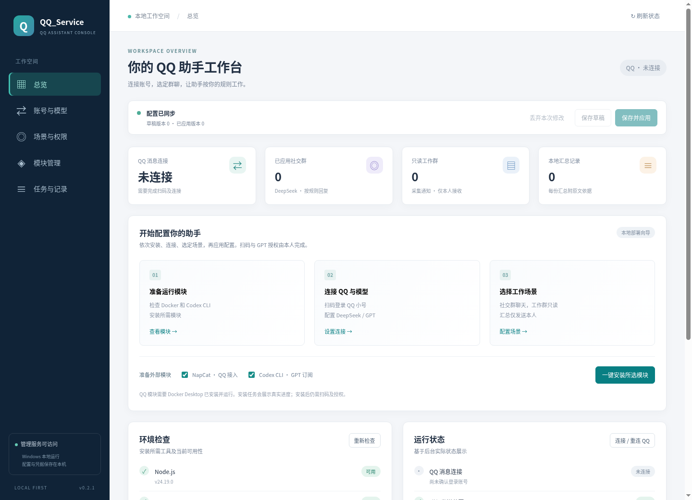
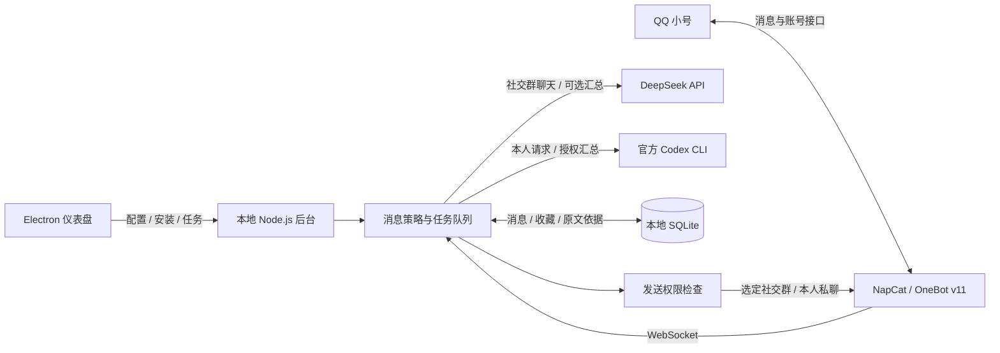

# QQ_Service

**在自己的 Windows 电脑上，把 QQ、DeepSeek 和个人 GPT 订阅集中到一个应用里。**

[](https://github.com/klwb360/QQ_Service/actions/workflows/windows.yml)
[](https://github.com/klwb360/QQ_Service/releases/latest)
[](LICENSE)

[下载 Windows EXE](https://github.com/klwb360/QQ_Service/releases/latest) · [使用指南](docs/USAGE.md) · [功能实现与架构](docs/ARCHITECTURE.md) · [开发指南](docs/DEVELOPMENT.md) · [验证记录](docs/VALIDATION.md)

QQ_Service 是本地 QQ 助手：在选定社交群里聊天，收集选定工作群的通知并解释给本人，整理当前 QQ 账号的「我的收藏」。通过仪表盘安装模块、登录账号、调整参数和应用配置，无需逐个编辑配置文件。



*v0.2.1 实际页面截图；使用全新本地数据，尚未安装模块或登录账号。EXE 使用同一界面，并提供独立窗口与托盘。*

## 下载与快速开始

当前版本：**v0.2.1**，适用于 **Windows 10/11 x64**。

| 下载 | 说明 |
| --- | --- |
| [QQ_Service-0.2.1-Windows-x64.exe](https://github.com/klwb360/QQ_Service/releases/download/v0.2.1/QQ_Service-0.2.1-Windows-x64.exe) | 便携应用，自带 Node.js 和 npm，双击启动 |
| [SHA256 校验文件](https://github.com/klwb360/QQ_Service/releases/download/v0.2.1/QQ_Service-0.2.1-Windows-x64.exe.sha256) | 用于核对下载文件 |
| [最新发布与更新说明](https://github.com/klwb360/QQ_Service/releases/latest) | 查看后续版本和发布记录 |

1. **打开应用**：下载 EXE，放入普通文件夹后双击。无需另装 Node.js。
2. **安装模块**：QQ 接入需先安装并启动 [Docker Desktop](https://docs.docker.com/desktop/setup/install/windows-install/)，使用 Linux 容器。在仪表盘点击「一键安装所选模块」；需要个人 GPT 订阅时勾选 Codex CLI。
3. **连接账号与模型**：打开 QQ 登录页面，扫码登录小号；填写本人与机器人 QQ 号、DeepSeek API Key。GPT 订阅通过官方 Codex 设备码授权登录。
4. **选定群与功能**：把群设为「社交群」或「工作群」，调整触发方式、汇总模型、时间和消息保留天数。
5. **保存并应用**：应用配置后查看连接状态。关闭窗口会收进托盘并继续运行；「完全退出」停止消息后台。

首次安装外部模块需要联网；安装完成、服务运行、账号登录和模型可用分别显示。EXE 当前未签名。详细操作、私聊命令与数据备份见 [使用指南](docs/USAGE.md)。

## 功能与实现

| 功能 | 目前如何实现 |
| --- | --- |
| Windows 应用 | Electron 管理独立窗口、单实例与托盘；附带 Node.js 运行本地后台 |
| 参数配置 | 表单 → 后台校验 → 保存草稿 → 应用运行配置；支持上一份配置回滚与脱敏导出 |
| 一键安装 | 后台执行固定安装动作：Docker 安装 NapCat，npm 安装官方 Codex CLI；显示进度和错误 |
| 社交群聊天 | NapCat 接收 QQ 消息，按 @、命令前缀或插话概率触发 DeepSeek；带上下文和冷却时间 |
| GPT 个人订阅 | 调用已通过本人 ChatGPT 账号登录的官方 Codex CLI，用于本人私聊和明确授权的汇总 |
| 工作通知汇总 | 选定工作群消息存入 SQLite，手动或每日定时交给模型解释，保留原文依据，只发本人私聊 |
| QQ 收藏整理 | 通过 NapCat 读取当前登录账号的收藏列表摘要，缓存后由模型整理，保留收藏 ID 与原摘要 |

所有 QQ 发送都经过后台权限检查：**工作群和未选群禁止发送；社交群只使用 DeepSeek；个人订阅不供群友调用。**



各功能的代码入口、消息处理过程与后续平台扩展方式见 [功能实现与架构](docs/ARCHITECTURE.md)。

## 当前范围与验证状态

- **QQ 来源**：只收集机器人连接后实际收到的选定群消息，不回填完整历史。小号不能读取主号收藏；收藏暂为列表摘要，不含完整正文、图片或附件。
- **GPT 接入**：使用 Codex 当前可用模型和订阅额度；ChatGPT 网页历史、记忆与自定义 GPTs 不会自动带入。额度不足时任务失败，不自动切换到付费 API。
- **本地运行**：应用保持运行才会采集和定时汇总；配置、消息和凭据保存在本机。首版支持一个 QQ 账号，新增平台需要开发适配器。
- **验证**：v0.2.1 的 Windows 自动测试、EXE 构建和 Release 发布已通过；已有 Linux Electron 交互检查。Windows 桌面实机操作及真实 QQ、DeepSeek、ChatGPT 账号联调仍待完成。

具体使用边界见 [使用指南](docs/USAGE.md)，已完成和待完成的检查见 [验证记录](docs/VALIDATION.md)。

## 文档与源码导航

| 文档 | 内容 |
| --- | --- |
| [使用指南](docs/USAGE.md) | 安装登录、群权限、私聊命令、收藏、数据与常见问题 |
| [功能实现与架构](docs/ARCHITECTURE.md) | 各功能代码入口、处理流程、配置语义与扩展方式 |
| [开发指南](docs/DEVELOPMENT.md) | 源码启动、Windows 打包、版本发布与环境变量 |
| [验证记录](docs/VALIDATION.md) | 自动测试、桌面交互检查与真实账号验收范围 |
| [第三方声明](THIRD_PARTY_NOTICES.md) | 附带运行环境与外部模块的许可证 |

```text
desktop/                  Electron 窗口、托盘与后台生命周期
public/                   仪表盘 HTML / CSS / JavaScript
src/server.mjs            本地 HTTP API、安装任务与配置应用
src/config.mjs            默认参数与配置校验
src/installer.mjs         NapCat / Codex 安装与状态检查
src/runtime.mjs           QQ 连接、聊天策略、汇总与发送权限
src/providers.mjs         DeepSeek API / Codex CLI 模型调用
src/store.mjs             配置、凭据与 SQLite 数据
scripts/                  运行环境准备与打包校验
.github/workflows/        Windows 自动测试、构建与发布
```

开发需要 Node.js 24；源码可以先用浏览器运行仪表盘：

```bash
git clone https://github.com/klwb360/QQ_Service.git
cd QQ_Service
npm ci --ignore-scripts
npm start
```

打开 `http://127.0.0.1:3210`。桌面开发、测试和 EXE 构建命令见 [开发指南](docs/DEVELOPMENT.md)。

项目自身代码采用 [MIT 许可证](LICENSE)。外部模块使用各自许可证；NapCat 的商业用途与分发限制见 [第三方声明](THIRD_PARTY_NOTICES.md)。
