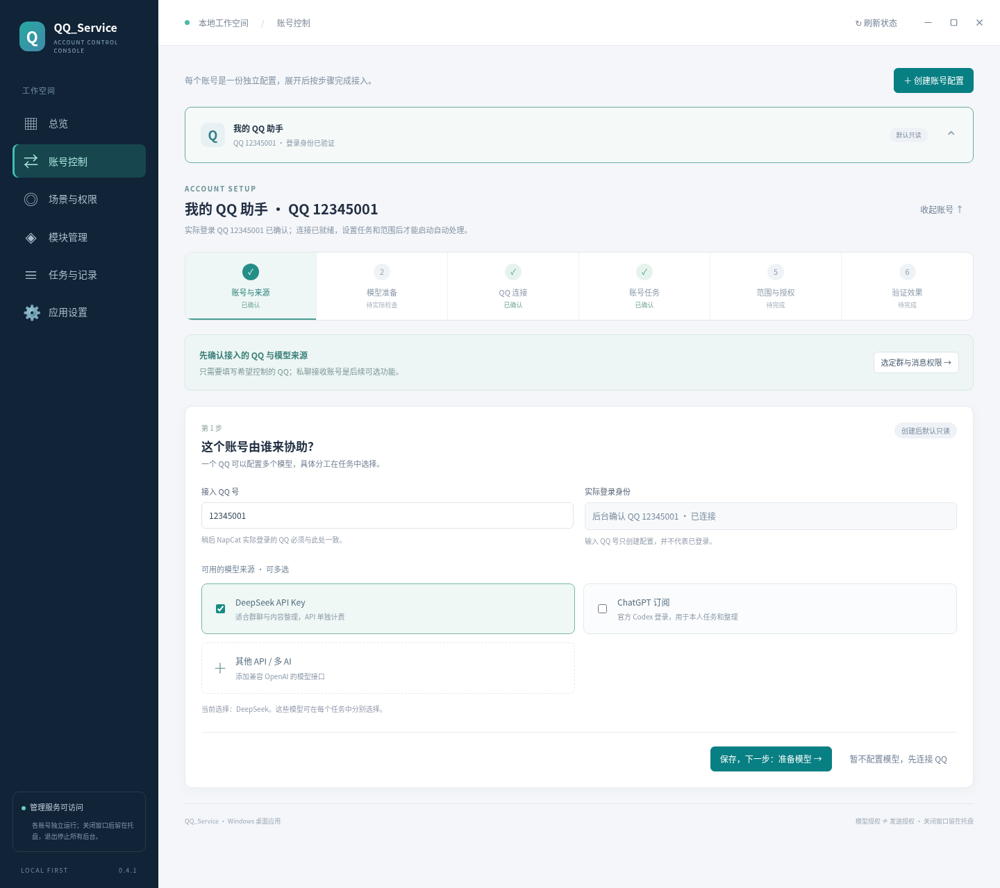
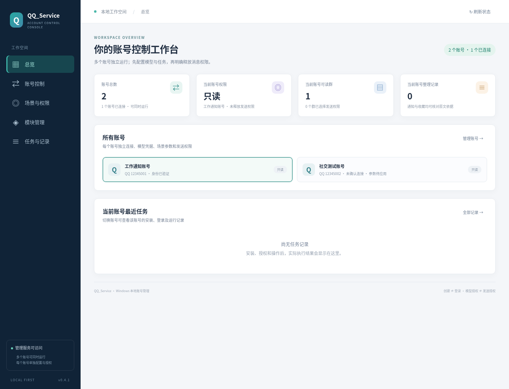
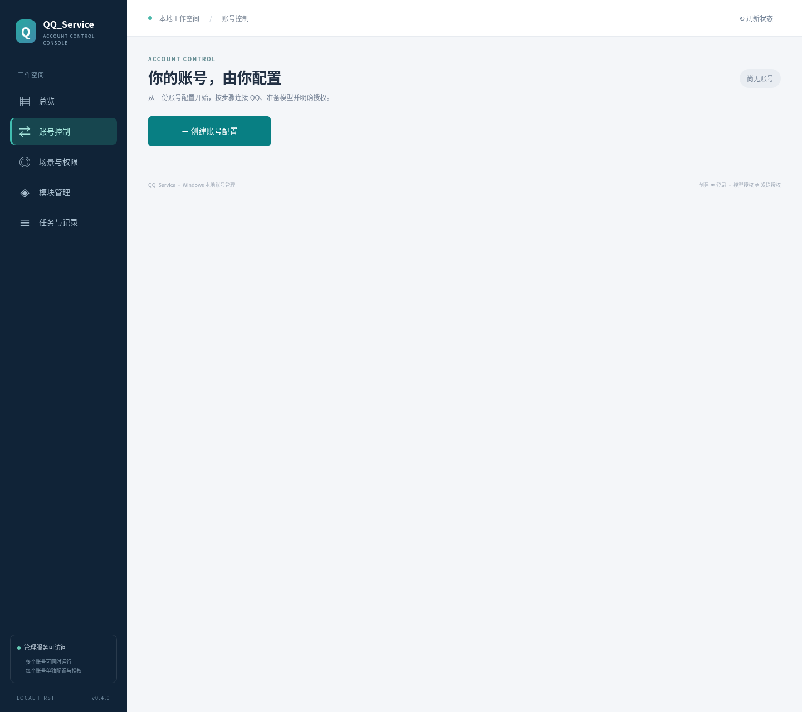
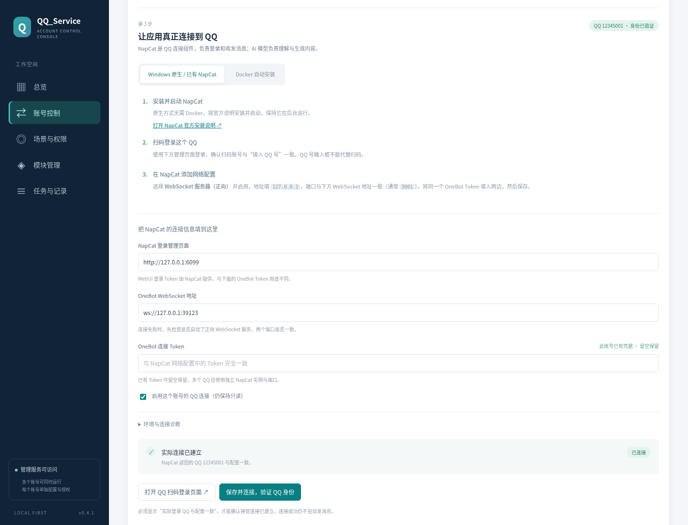
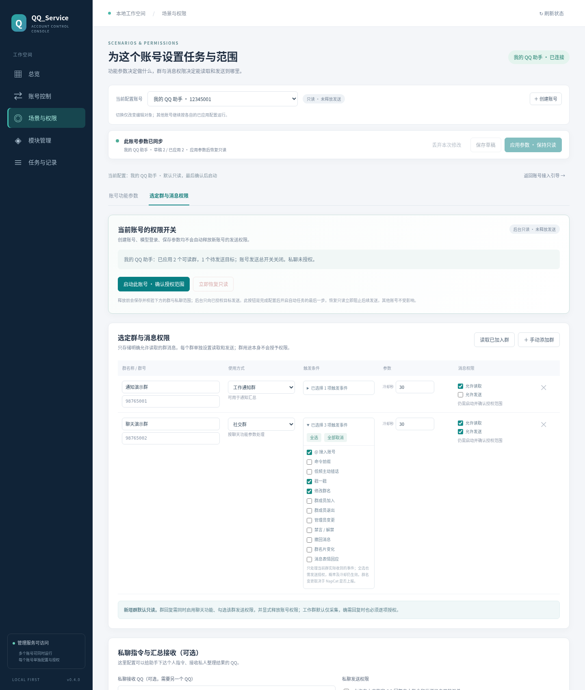
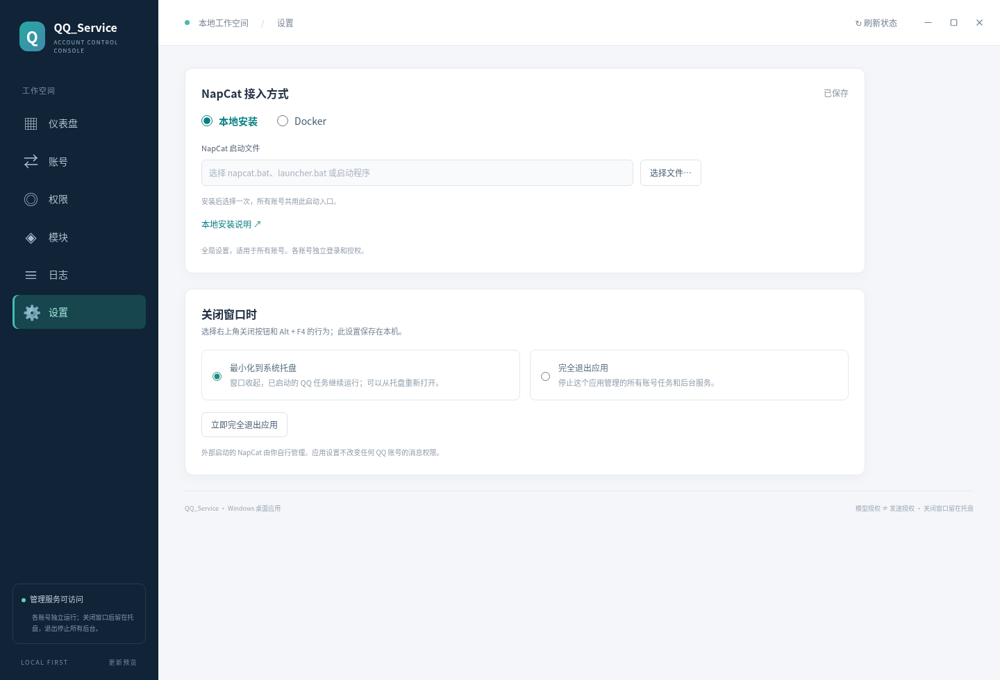
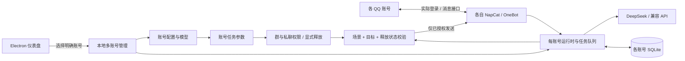

# QQ_Service

**在自己的电脑或 Docker 中，按步骤连接 QQ，选择模型 API，并管理每个账号的人格、记忆、功能与权限。**

[](https://github.com/klwb360/QQ_Service/actions/workflows/windows.yml)
[](https://github.com/klwb360/QQ_Service/releases/latest)
[](LICENSE)

[下载 Windows EXE](https://github.com/klwb360/QQ_Service/releases/latest) · [使用指南](docs/USAGE.md) · [自由群聊与记忆](docs/SOCIAL_CHAT.md) · [MCP 接入](docs/MCP.md) · [无需 Docker 接入 QQ](docs/NATIVE_NAPCAT_WINDOWS.md) · [功能实现与架构](docs/ARCHITECTURE.md) · [开发指南](docs/DEVELOPMENT.md) · [验证记录](docs/VALIDATION.md)

QQ_Service 是支持多个 QQ 账号同时在线的本地助手。「账号控制」集中管理创建与配置：每个账号是一条可展开的菜单，从账号信息开始逐段向下完成模型、QQ 登录、功能与权限配置，已填写的内容保留在上方。总览只显示关键统计、运行状态和最近任务，统计卡片可点击进入对应页面。支持 DeepSeek、OpenAI 和多组兼容 API。**新账号默认只读；填入 QQ 号或 API Key 都不会自动运行场景或获得发送权限。**

v0.7.0 起仅通过 API 接入模型，已移除 ChatGPT 订阅／Codex 安装和登录。需要 OpenAI 专用 Key 时，见 [机器人专用 API 配置](docs/OPENAI_API_SETUP.md)。

v0.8.0 增加角色卡预览与历史回退、自动经历札记、可清空的当前会话状态和 Docker 网页部署。NapCat Shell 可正常使用；SnowLuma 已准备独立适配和[安全审查记录](docs/SNOWLUMA_SECURITY_REVIEW.md)，Windows 隔离验证未完成前保持禁用。人格与记忆使用同一稳定账号身份，不因连接端改变而重建。见 [人格与记忆](docs/PERSONA_MEMORY.md)、[Docker 部署](docs/DOCKER.md)。

开发分支正在加入标准 MCP 客户端：支持本地 stdio、Streamable HTTP 和旧版 SSE，沿用每账号、群和调用人授权，按需加载工具。进程内 QQ MCP 提供18项受限工具；另随附 Bilibili 聊天后台总结、计算／临时笔记、公开网页搜索／读取三套可选服务。八个精选入口帮助准备配置，**不会自动安装、登录或启动第三方应用**；Slack OAuth当前尚不支持。Bilibili可在聊天中选择来源、内容日期和每日运行时段，结果返回原会话，无字幕时注明元数据范围。已发布的 v0.8.0 EXE 尚不包含这些开发分支功能，见 [MCP指南](docs/MCP.md) 与 [精选入口](docs/MCP_PRESETS.md)。

开发分支增加按群批准的图片、表情和文档素材库，可从NapCat同步本人收藏表情。本人可使用当前已启用且支持图片的兼容API显式识别并缓存标签；保持每账号单选主LLM，DeepSeek文字通道不能看图，可使用手工／缓存描述选择表情，聊天不会默认分析群图片。每群可另行批准5项自然QQ互动并独立限频；文件及其他应用写入仍单独授权。见 [素材与视觉](docs/QQ_ASSETS.md)。

开发分支同时将记忆保存上限提高为原来的11倍：对话原文可保留330天，人工记忆和经历札记允许保存更长内容。设置中可选择独立的记忆目录，完全退出并重启后迁移，账号配置、密钥和消息权限保持在原资料目录。扩大的是保存容量，每轮模型检索与上下文预算不随之增加。



<details>
<summary>查看简化后的总览</summary>



</details>

<details>
<summary>首次使用：只有创建账号入口</summary>



</details>

<details>
<summary>查看 QQ 连接步骤</summary>



</details>

<details>
<summary>查看「选定群与消息权限」界面</summary>



</details>

<details>
<summary>查看全局 NapCat 接入设置</summary>



</details>

*界面截图不包含真实账号、凭据或群消息。Windows EXE 提供独立窗口与托盘。*

## 下载与快速开始

当前版本：**v0.8.0**，桌面版适用于 **Windows 10/11 x64**，网页服务也可在 Docker 中运行。

| 下载 | 说明 |
| --- | --- |
| [QQ_Service-0.8.0-Windows-x64.exe](https://github.com/klwb360/QQ_Service/releases/download/v0.8.0/QQ_Service-0.8.0-Windows-x64.exe) | 便携应用，自带 Node.js 和 npm，双击启动 |
| [SHA256 校验文件](https://github.com/klwb360/QQ_Service/releases/download/v0.8.0/QQ_Service-0.8.0-Windows-x64.exe.sha256) | 用于核对下载文件 |
| [最新发布与更新说明](https://github.com/klwb360/QQ_Service/releases/latest) | 查看已发布版本和更新记录 |

1. **创建账号配置**：创建入口只在「账号控制」显示。输入希望接入的 QQ 号，从下拉栏选择一个 API 厂商。每个账号的栏头与展开内容连为同一菜单，可点击栏头展开或收起，参数与数据分别保存，多个账号可以同时运行。完成一部分并继续后，下一部分带动画向下展开，之前的表单保持可见，无需切换顶部步骤标签。
2. **准备模型**：选择 DeepSeek、OpenAI 或兼容 API 厂商并填写模型与 Key；当前账号的任务使用所选模型。
3. **实际登录 QQ**：NapCat 是 QQ 登录与消息接口组件。先在「设置」全局选择本地安装或 Docker。本地方式按 [原生指南](docs/NATIVE_NAPCAT_WINDOWS.md) 安装并选择启动文件；Docker 方式在「模块」安装。回到「连接 QQ」点击 **打开 NapCat → 打开登录页 → 连接并继续**，核对实际登录账号。
4. **选择账号功能**：按需启用聊天回复、工作通知汇总或收藏整理，设置触发方式、模型和计划。暂不使用的功能可以关闭。
5. **选择群并启动**：到「选定群与消息权限」读取实际已加入群，明确读取、发送范围，确认后点击 **启动此账号**，显式授予已配置权限。只在面板看通知无需另一个 QQ 号，也不需要私聊发送权限。
6. **验证一次完整流程**：先确认 QQ 连接和身份，再检查模型；让选定群产生一条新消息，确认记录，最后按授权范围测试汇总或回复。面板将缺少的参数、连接或授权列为待办，见 [首次连接验证](docs/USAGE.md#6-验证一次完整流程)。

EXE 当前未签名。详细操作、私聊命令与备份见 [使用指南](docs/USAGE.md)。

Docker 用户在仓库目录运行 `docker compose up -d --build`，访问 `http://127.0.0.1:8787`。容器包含服务端和网页仪表盘，QQ 连接端独立运行；不需要把宿主机 Docker socket 或整个文件系统交给应用。详见 [部署与备份](docs/DOCKER.md)。

## 功能与实现

| 功能 | 目前如何实现 |
| --- | --- |
| 多账号控制 | 本地账号目录保存稳定 ID；每账号独立配置、凭据、SQLite、QQ 连接、任务队列 |
| 权限配置 | 账号功能参数与群/私聊权限分开；默认只读，独立释放/撤销入口，自动场景和发送由后台分别核对 |
| Windows 应用 | Electron 自绘标题栏和窗口按钮，管理单实例与托盘；附带 Node.js 运行本地后台 |
| 一键安装 | NapCat 接入方式全局设置；本地安装后选择启动文件，或按账号安装 Docker 容器；模型 API 无需安装 CLI |
| 插件与 AI 工具调用 | 模块页导入可信插件，为账号、群和调用人授权工具；支持真实 @、戳一戳及名字／别名唤醒，自定义 Skill 与插件独立加密凭据。AI 可选择已授权工具执行；写入需明确请求和额外授权。见 [开发指南](docs/PLUGIN_DEVELOPMENT.md)、[Bilibili 示例](examples/plugins/bilibili-assistant) |
| QQ 内置 MCP（开发分支） | 默认关闭的18项工具：本群消息、成员、群资料、公告／文件目录，以及受管媒体、真实@／引用、回应、转发和本人消息撤回。统一权限与防重复发送门，无任意OneBot透传或外部服务端口；普通写请求按调用人授权，自然互动另由主人按群批准 |
| 图片、表情与视觉（开发分支） | 本人导入或同步QQ收藏表情，明确可用群；AI按缓存描述选择，不合适则不发。视觉识别仅本人主动调用当前已启用且支持图片的兼容API，DeepSeek-only可用手工标签；文件传输不等于读取正文 |
| 自由群聊与主动分享 | 每群单独开启；记录双向对话、合并短消息并接住追问，AI 判断接话或沉默；可使用独立授权的只读工具寻找素材，自行决定是否分享。见 [配置指南](docs/SOCIAL_CHAT.md) |
| 群友记忆 | 设置中按账号、实际 QQ、群和成员管理明确事实与偏好；AI 提出候选，经主人确认后用于聊天，可编辑、删除或逐群暂停 |
| 人格与经历 | 每个 QQ 一套人格，按群覆盖风格；Markdown 角色卡、提示预览和历史草稿回退；有真实来源的自身经历自动积累，可暂停、编辑、归档或删除 |
| 当前会话 | 按群保存临时话题、近期参与者与待续事项，默认两小时有效；清空后不再向模型带入清空前短上下文，长期事实和历史原文保留 |
| Docker 网页版 | Node.js 服务与仪表盘打包为非 root 容器，数据卷保存配置、加密凭据和 SQLite；默认仅本机访问 |
| 多 AI 配置 | 提供 DeepSeek、OpenAI、百炼、智谱、Kimi、硅基流动及自定义兼容 API 选项；每个账号从下拉栏选择一个模型来源，已保存的其他接口参数可保留 |
| 通知汇总 | 当前账号的可读工作群消息存入 SQLite，手动或定时交给所选模型解释；默认保存在本地，可授权私聊发送 |
| 收藏整理 | 读取当前登录账号的收藏列表摘要，使用独立选择的整理模型，保存收藏 ID 和原摘要 |

**工作群默认不发送；用户也可以明确授予其 API 模型回复权限。**「工作群/社交群」描述用途，实际权限由读取、发送和账号释放状态共同决定。所有模型任务均使用配置好的 API；未选群和未授权目标不能发送。



## 当前范围与验证状态

- **QQ 来源**：只缓存连接后实际收到、且已授予读取权限的选定群消息，不回填完整历史。收藏只属于实际登录账号，暂为列表摘要，不含完整正文、图片或附件。
- **OpenAI 接入**：使用专用 API 项目和 Key；符合条件的 Pro／Business 额度须先在官方页面激活到正确组织。ChatGPT 网页历史、记忆和自定义 GPTs 不会带入，API 失败不自动换用其他服务。见 [专用 API 配置](docs/OPENAI_API_SETUP.md)。
- **本地运行**：多个 QQ 账号可同时在线；应用后台保持运行才会采集和定时汇总。新账号数据相互分开，升级保留原目录与 QQ 登录资料；已有 API 配置和权限不变。旧订阅任务停用并恢复只读，需主动改选 API，不自动扩大授权。
- **自主聊天**：自由聊天、主动话题和群友记忆默认关闭，分别按群启用。主动检查与模型判断受预算约束，可以一直保持沉默；Bilibili 示例按视频元数据筛选，不具备完整视频观看能力。
- **后续平台**：微信、Telegram 的原生实时入站适配仍在规划；开发分支提供外部MCP配置入口，需用户自行安装与登录，不能等同于已接通实时监听。
- **验证**：自动测试、界面与桌面检查见 [验证记录](docs/VALIDATION.md)。正式 EXE 由 Windows CI 测试和构建；真实 QQ、模型 API 及 Windows 原生扫码联调仍待完成。

## 文档与源码导航

| 文档 | 内容 |
| --- | --- |
| [使用指南](docs/USAGE.md) | 创建账号、任务参数、读取与发送权限、私聊命令、收藏和备份 |
| [机器人专用 API](docs/OPENAI_API_SETUP.md) | 领取符合条件的 API 额度、创建独立项目／Key，并接入应用 |
| [自由群聊与记忆](docs/SOCIAL_CHAT.md) | 自然追问、内容驱动的主动分享、背景只读工具、群友记忆确认和排障 |
| [Windows 原生 NapCat](docs/NATIVE_NAPCAT_WINDOWS.md) | 无需 Docker 的官方安装器、每账号高级连接与端口配置 |
| [功能实现与架构](docs/ARCHITECTURE.md) | 多账号隔离、模型路由、权限门和旧版迁移 |
| [开发指南](docs/DEVELOPMENT.md) | 源码启动、测试、Windows 打包与发布 |
| [接口契约](docs/CONTRACT.md) | 开发分支 schema 4 配置和带账号 ID 的本地 API |
| [MCP 工具接入](docs/MCP.md) | 开发分支的服务导入、发现、工具审批、群授权与内置示例 |
| [MCP 精选入口](docs/MCP_PRESETS.md) | 八项配置准备入口、账号身份、平台前提、固定来源与许可 |
| [图片、表情与文件](docs/QQ_ASSETS.md) | 受管素材、收藏表情同步、可选视觉识别与自然互动 |
| [工具优化路线](docs/TOOL_ROADMAP.md) | 当前边界、真实链路验收与持续改进建议 |
| [验证记录](docs/VALIDATION.md) | 已完成检查及真实账号验收范围 |
| [第三方声明](THIRD_PARTY_NOTICES.md) | 附带运行环境与外部模块许可证 |

```text
desktop/                  Electron 窗口、托盘与后台生命周期
public/                   多账号仪表盘 HTML / CSS / JavaScript
src/server.mjs            本地 HTTP、请求隔离与多账号协调
src/accounts.mjs          稳定账号目录与可用/规划平台清单
src/account-service.mjs   各账号配置、安装任务与权限释放事务
src/config.mjs            默认参数、schema 4 校验与旧版迁移
src/installer.mjs         每账号 NapCat 安装与状态检查
src/runtime.mjs           QQ 连接、群列表、聊天、汇总与发送权限
src/providers.mjs         DeepSeek / OpenAI 兼容 API 模型调用
src/mcp-client.mjs        标准 SDK stdio / HTTP / SSE 连接
src/mcp-manager.mjs       每账号服务生命周期、工具发现与审批
src/mcp-schema.mjs        有界 JSON Schema Worker 校验
src/qq-mcp-server.mjs     当前 QQ 请求的进程内 MCP 服务与回执
src/qq-tools.mjs          本群缓存、成员和受限互动工具
src/qq-assets.mjs         按账号及群批准的素材与描述
src/asset-vision.mjs      当前兼容API的显式素材识别
src/qq-sticker-sync.mjs   收藏表情的受控读取、查重与导入
src/web-content.mjs       公开网页读取及固定来源图片传输
src/mcp-presets.mjs       只准备禁用配置的精选入口
src/memory-storage.mjs    独立记忆数据库、容量和目录迁移
src/store.mjs             每账号配置、凭据与 SQLite 数据
scripts/                  运行环境准备与打包校验
.github/workflows/        Windows 自动测试、构建与发布
```

开发需要 Node.js 24：

```bash
git clone https://github.com/klwb360/QQ_Service.git
cd QQ_Service
npm ci --ignore-scripts
npm start
```

打开 `http://127.0.0.1:3210`。项目自身代码采用 [MIT](LICENSE) 许可证；外部模块遵循各自许可证，NapCat 商业用途与分发限制见 [第三方声明](THIRD_PARTY_NOTICES.md)。
