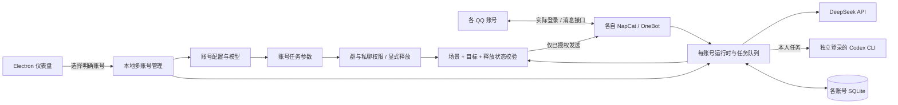

# QQ_Service

**在自己的 Windows 电脑上，按账号配置 QQ、DeepSeek 和个人 GPT 订阅。**

[](https://github.com/klwb360/QQ_Service/actions/workflows/windows.yml)
[](https://github.com/klwb360/QQ_Service/releases/latest)
[](LICENSE)

[下载 Windows EXE](https://github.com/klwb360/QQ_Service/releases/latest) · [使用指南](docs/USAGE.md) · [无需 Docker 接入 QQ](docs/NATIVE_NAPCAT_WINDOWS.md) · [功能实现与架构](docs/ARCHITECTURE.md) · [开发指南](docs/DEVELOPMENT.md) · [验证记录](docs/VALIDATION.md)

QQ_Service 是支持多个 QQ 账号同时在线的本地助手。先创建账号并配置模型，再为这个账号选择通知汇总、聊天回复或收藏整理，最后到独立的「选定群与消息权限」子菜单确定读取和发送范围、显式释放权限。**新账号默认只读；填入 QQ 号、API Key 或登录 Codex 都不会自动运行场景或获得发送权限。**


<details>
<summary>查看「选定群与消息权限」界面</summary>


</details>

*界面截图不包含真实账号、凭据或群消息。Windows EXE 提供独立窗口与托盘。*

## 下载与快速开始

文档版本：**v0.3.0**，适用于 **Windows 10/11 x64**。下载文件以对应 Release 的实际发布资产为准。

| 下载 | 说明 |
| --- | --- |
| [QQ_Service-0.3.0-Windows-x64.exe](https://github.com/klwb360/QQ_Service/releases/download/v0.3.0/QQ_Service-0.3.0-Windows-x64.exe) | 便携应用，自带 Node.js 和 npm，双击启动 |
| [SHA256 校验文件](https://github.com/klwb360/QQ_Service/releases/download/v0.3.0/QQ_Service-0.3.0-Windows-x64.exe.sha256) | 用于核对下载文件 |
| [最新发布与更新说明](https://github.com/klwb360/QQ_Service/releases/latest) | 查看已发布版本和更新记录 |

1. **创建账号**：在「账号控制」输入希望接入的 QQ 号，并给配置起名。每个账号有自己的参数与数据，可以同时运行。
2. **完成 QQ 登录**：NapCat 是负责 QQ 登录和消息接口的连接组件，模型通过它接收资料或执行获准的回复。输入 QQ 号只是配置目标，仍需实际扫码登录。可按 [Windows 原生指南](docs/NATIVE_NAPCAT_WINDOWS.md) 无需 Docker 部署；应用内 NapCat 安装按钮仍需先准备 [Docker Desktop](https://docs.docker.com/desktop/setup/install/windows-install/)。
3. **配置模型与任务**：为该账号填写 DeepSeek API Key，或安装 Codex CLI 并完成官方 ChatGPT 授权；在「场景与权限 → 账号功能参数」选择聊天、通知汇总及收藏整理的模型与参数。
4. **最后授予权限**：在「选定群与消息权限」添加或读取已加入群，逐项设置读取、发送与可选私聊接收对象。检查后点击 **检查并释放此账号权限**，才允许自动聊天和定时整理；可保持群发送关闭，只自动本地汇总。普通「保存并应用」更新参数并回到只读，面板手动整理仍可本地运行。
5. **查看实际状态**：安装、服务运行、QQ 登录、模型授权和权限分别显示。关闭窗口会收进托盘；「完全退出」停止所有账号的应用后台。

EXE 当前未签名。详细操作、私聊命令与备份见 [使用指南](docs/USAGE.md)。

## 功能与实现

| 功能 | 目前如何实现 |
| --- | --- |
| 多账号控制 | 本地账号目录保存稳定 ID；每账号独立配置、凭据、SQLite、QQ 连接、任务队列和 Codex 登录目录 |
| 权限配置 | 账号功能参数与群/私聊权限分开；默认只读，独立释放/撤销入口，自动场景和发送由后台分别核对 |
| Windows 应用 | Electron 管理窗口、单实例与托盘；附带 Node.js 运行本地后台 |
| 一键安装 | 每账号执行固定安装动作：Docker 安装 NapCat，npm 安装官方 Codex CLI；原生 NapCat 可手动接入 |
| 群聊回复 | 获准读取及发送的群按 @、前缀或插话概率调用 DeepSeek；带上下文和冷却时间 |
| GPT 个人订阅 | 使用本人已登录的官方 Codex CLI，处理本人私聊及明确发起或授权的个人整理任务 |
| 通知汇总 | 当前账号的可读工作群消息存入 SQLite，手动或定时交给所选模型解释；默认保存在本地，可授权私聊发送 |
| 收藏整理 | 读取当前登录账号的收藏列表摘要，使用独立选择的整理模型，保存收藏 ID 和原摘要 |

**工作群默认不发送；用户也可以明确授予其 DeepSeek 回复权限。**「工作群/社交群」描述用途，实际权限由读取、发送和账号释放状态共同决定。个人 Codex 订阅不用于群友触发的自动群聊，未选群和未授权目标不能发送。



## 当前范围与验证状态

- **QQ 来源**：只缓存连接后实际收到、且已授予读取权限的选定群消息，不回填完整历史。收藏只属于实际登录账号，暂为列表摘要，不含完整正文、图片或附件。
- **GPT 接入**：使用 Codex 当前模型与订阅额度；ChatGPT 网页历史、记忆和自定义 GPTs 不会自动带入。额度不足不自动切换付费 API。
- **本地运行**：多个 QQ 账号可同时在线；应用后台保持运行才会采集和定时汇总。新账号数据相互分开，旧版升级保留原目录、登录状态和既有权限，不扩大授权。
- **后续平台**：微信、Telegram 目前仅列入平台扩展规划，没有可用接入实现。
- **验证**：自动测试、界面与桌面检查见 [验证记录](docs/VALIDATION.md)。正式 EXE 由 Windows CI 测试和构建；真实 QQ、DeepSeek、ChatGPT 及 Windows 原生扫码联调仍待完成。

## 文档与源码导航

| 文档 | 内容 |
| --- | --- |
| [使用指南](docs/USAGE.md) | 创建账号、任务参数、读取与发送权限、私聊命令、收藏和备份 |
| [Windows 原生 NapCat](docs/NATIVE_NAPCAT_WINDOWS.md) | 无需 Docker 的官方安装器、每账号高级连接与端口配置 |
| [功能实现与架构](docs/ARCHITECTURE.md) | 多账号隔离、模型路由、权限门和旧版迁移 |
| [开发指南](docs/DEVELOPMENT.md) | 源码启动、测试、Windows 打包与发布 |
| [接口契约](docs/CONTRACT.md) | schema 2 配置和带账号 ID 的本地 API |
| [验证记录](docs/VALIDATION.md) | 已完成检查及真实账号验收范围 |
| [第三方声明](THIRD_PARTY_NOTICES.md) | 附带运行环境与外部模块许可证 |

```text
desktop/                  Electron 窗口、托盘与后台生命周期
public/                   多账号仪表盘 HTML / CSS / JavaScript
src/server.mjs            本地 HTTP、请求隔离与多账号协调
src/accounts.mjs          稳定账号目录与可用/规划平台清单
src/account-service.mjs   各账号配置、安装任务与权限释放事务
src/config.mjs            schema 2 默认参数、校验与旧版迁移
src/installer.mjs         每账号 NapCat / Codex 安装与状态检查
src/runtime.mjs           QQ 连接、群列表、聊天、汇总与发送权限
src/providers.mjs         DeepSeek API / Codex CLI 模型调用
src/store.mjs             每账号配置、凭据与 SQLite 数据
scripts/                  运行环境准备与打包校验
.github/workflows/        Windows 自动测试、构建与发布
```

开发需要 Node.js 24：

```bash
git clone https://github.com/klwb360/QQ_Service.git
cd QQ_Service
npm ci --ignore-scripts
npm start
```

打开 `http://127.0.0.1:3210`。项目自身代码采用 [MIT](LICENSE) 许可证；外部模块遵循各自许可证，NapCat 商业用途与分发限制见 [第三方声明](THIRD_PARTY_NOTICES.md)。
