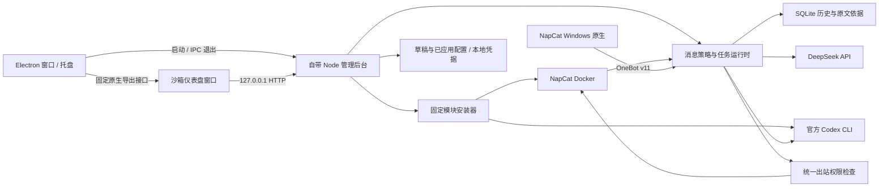

# 功能实现与架构

[返回首页](../README.md) · [使用指南](USAGE.md) · [开发指南](DEVELOPMENT.md)

QQ_Service 采用一个 Electron 桌面壳、一个本地 Node.js 后台和两个按需安装的外部模块。QQ 连接交给 NapCat，个人 GPT 订阅交给官方 Codex CLI；聊天、权限、汇总、收藏和配置管理由项目自己的代码实现。

OneBot 消息运行时不依赖 Docker，可以直接连接原生 NapCat。当前安装器管理的是 Docker 部署；Windows 原生方式由官方安装器单独部署并提供同一本机接口，见 [原生接入指南](NATIVE_NAPCAT_WINDOWS.md)。

## 各功能的代码入口

| 功能 | 主要代码 | 实现方式 |
| --- | --- | --- |
| 界面与参数表单 | [public/index.html](../public/index.html)、[public/app.js](../public/app.js) | 原生 HTML/CSS/JS 调用本地 API，显示状态、编辑草稿和执行固定操作 |
| EXE、托盘与后台 | [desktop/main.cjs](../desktop/main.cjs)、[desktop/preload.cjs](../desktop/preload.cjs) | Electron 单实例窗口、托盘、原生导出；启动附带 Node 子进程，通过 IPC 管理退出 |
| 配置管理 | [src/config.mjs](../src/config.mjs)、[src/server.mjs](../src/server.mjs) | 校验参数与依赖，区分草稿和已应用配置，保存上一份配置并在应用失败时恢复 |
| 一键安装 | [src/installer.mjs](../src/installer.mjs) | 固定模块目录与命令参数；Docker 安装 NapCat，npm 安装 Codex，分别检查安装和运行状态 |
| QQ 消息与群聊 | [src/runtime.mjs](../src/runtime.mjs) | OneBot v11 WebSocket、登录身份校验、触发规则、队列、冷却、断线重连和统一发送权限 |
| DeepSeek / GPT | [src/providers.mjs](../src/providers.mjs) | DeepSeek 官方 HTTP API；官方 Codex CLI 子进程，解析完成结果与错误 |
| 通知 / 收藏整理 | [src/runtime.mjs](../src/runtime.mjs) | `runSummary`、`scheduleTick`、`syncFavorites`、`runFavoritesSummary` 组织来源、调用模型、保存依据和发送结果 |
| 本地存储 | [src/store.mjs](../src/store.mjs) | JSON 配置、AES-GCM 凭据及 SQLite 消息、收藏、汇总与任务记录 |

## 总体流程



`src/server.mjs` 管理 HTTP 接口、请求保护、异步安装任务、配置应用及恢复。`src/config.mjs` 校验统一配置。`src/store.mjs` 保管凭据、消息和依据。`src/installer.mjs` 管理外部模块、固定版本与本机 Docker。`src/runtime.mjs` 负责 OneBot、用途策略、队列、定时汇总和发送；`src/providers.mjs` 封装模型调用。

`desktop/main.cjs` 管理单实例、窗口、托盘、原生菜单与后台生命周期；后台用独立 Node 24 运行，避免依赖 Electron 内置 Node 的 SQLite 支持。`desktop/preload.cjs` 只暴露桌面标识、版本和脱敏配置导出；渲染层关闭 Node integration，启用 context isolation 与 sandbox。页面导航和资源仅允许本次后台地址，官方授权外链交给默认浏览器。后台收到 IPC 退出或父连接断开时清理运行时和安装子进程；超时仅强制清理本应用的后台进程树。

`scripts/prepare-windows.mjs` 校验官方 Windows Node ZIP，再将生产后台、固定依赖与运行环境放到构建暂存目录。`electron-builder.yml` 将桌面壳打进 ASAR、Node/backend 作为独立 resources，生成便携 EXE。用户资料始终在 LocalAppData，而非便携展开目录。

首版选择内置轻量运行时，统一控制消息发送与模型路由。AstrBot 没有作为必装依赖。后续可以使用它的 [公开 HTTP API](https://github.com/AstrBotDevs/AstrBot/blob/v4.28.2/docs/zh/dev/openapi.md) 加入配置档与插件管理适配器；接入时仍需确保所有发送经过统一网关，不能只依赖提示词或关闭 LLM 的配置。

## 聊天与模型路由

NapCat 登录机器人 QQ 后提供 OneBot v11 WebSocket。`runtime.mjs` 连接本机接口，核对实际登录账号，接收消息并转为统一输入。只有选定群的消息进入缓存；未选群不触发模型。

社交群按真实 @、命令前缀或插话概率决定是否回复，再检查冷却时间。上下文按账号、群和用途过滤，调用 `providers.mjs` 中的 DeepSeek 通道。模型结果发送前重新检查当前权限，因此工作群和未选群不会成为出站目标。

本人私聊普通文字或 `/ds` 走 DeepSeek，`/gpt` 走 Codex。Codex 通过官方 `login --device-auth` 完成 ChatGPT 登录，使用独立 `CODEX_HOME` 与工作目录，通过 `exec` 处理文字；不读取 ChatGPT 网页会话，也不使用网页 token 代理。子进程环境不继承付费 API 凭据，额度失败不做 API 回退。

Codex 推理使用只读沙箱、忽略用户配置与规则，并关闭多项工具功能；若事件流出现工具执行事件，拒绝任务结果。当前用途是文字处理，这些限制不等于独立操作系统隔离。

## 工作通知与收藏

工作群消息只写入本地 SQLite，不逐条调用模型。手动汇总或每日定时任务读取当前账号的该群缓存，限制消息数量和文字长度，把消息 ID、发送者、时间和原文传给所选模型。输出解释通知、术语、行动项与原文期限；程序核对引用 ID，并保存输入依据与实际送达状态。结果只允许发送到本人私聊，也可选择仅保存在本地。

每日任务使用运行电脑的本地时间，通过任务记录按群和日期去重；需要本人明确授权。应用退出、休眠或错过执行时间时不补跑。

收藏通过 NapCat 的 `get_collection_list` 读取当前账号的列表摘要，缓存收藏 ID、账号、时间和摘要。整理时检查缓存账号与当前账号一致，再调用汇总模型并核对收藏引用 ID。收藏整理可以独立于工作群汇总开关使用，但不运行定时收藏任务。当前没有收藏全文、附件、完整分页或跨账号收藏读取。

## 模块安装与本地数据

安装器只有固定动作，前端提交模块 ID，不提交 shell 命令。外部进程使用固定参数和 `shell: false`。NapCat 镜像及 Codex 包固定版本，NapCat 拉取后记录镜像摘要；状态和错误由实际环境检查及任务输出获得。DeepSeek、通知汇总和收藏是内置功能，不是额外下载的插件。

配置存放在 `config.json`；凭据存放在 `vault.json`，使用同目录 `vault.key` 加密；消息、汇总、收藏和任务存放在 `history.sqlite`。Codex 登录资料由 CLI 自行保存在独立目录。Windows 数据目录保留 `%LOCALAPPDATA%\QQBridgeDashboard`，更换 EXE 不改变资料位置。

## 必须保持的约束

1. 社交群只能调用 DeepSeek；GPT 订阅只有本人私聊、本人明确发起或授权的汇总可以使用。
2. 工作群和未选定群不能成为出站目标。即使任务发生错误，也不能把错误提示发到工作群。
3. 工作、收藏与社交聊天上下文分开；新平台也必须按账号、会话和用途过滤资料。
4. 运行中的旧模型任务在配置变更时取消；发送前按最新配置再次校验目标。
5. 前端不能提交任意 shell 命令、任意下载源、任意文件路径或直接拿到 OneBot/API 凭据。
6. 安装、服务运行、账号登录、模型连通是四种不同状态，分别显示。

## 后续增加模块

安装器当前的模块目录定义包括 `id/name/kind/description`，外部模块另有固定版本、官方地址、持久目录和状态检查。增加一个模块需要实现对应固定动作与检查方法，不能把输入命令交给 shell。

建议第二版把目录提取为模块 manifest，再实现安装任务的持久化、取消和显式更新/卸载。第一版不会静默更新上游镜像或执行任意第三方插件。

## 后续增加应用

第一版只支持一个 QQ 小号。未来新增 Telegram、飞书等适配器时，先将 OneBot 接收/操作从 `runtime.mjs` 提取为平台接口：

```text
Adapter.connect() / disconnect() / identity()
Adapter.onMessage -> {platform,accountId,sessionId,messageId,userId,time,text}
Adapter.send(destination,text)   // 只由权限网关调用
Adapter.readSources(options)    // 能力明确标注，不假定各平台都有收藏/历史
```

工作流继续引用统一的消息、来源与模型接口。数据库已有账号、群、消息、用户和时间元数据；多平台接入前需增加 platform/sessionId 并迁移唯一键。现阶段不宣称可以无需改代码安装任意平台。

## 配置应用语义

保存只写草稿和待应用凭据；应用进行依赖校验，再切换运行配置。配置或 OneBot Token、端口、机器人账号发生变化时重载相应部分。后台记录上一份普通配置；应用抛错时恢复配置与凭据并尝试恢复运行时。

账号是否登录以及第三方网络是否可用异步显示，连接失败不伪造成功，也不因临时网络失败丢弃用户已应用的参数。模块安装失败保留可诊断信息，已下载的独立模块保留，用户可重试。第一版不是跨文件系统、Docker 和远端账号的分布式事务；已发生的外部发送无法回滚。

## 验证边界

自动测试覆盖最重要的权限和配置语义，使用本地模拟 OneBot 与模型。v0.2.1 已通过 Windows runner 的自动测试、打包与 Release 发布。Windows 桌面启动及托盘操作、Docker Desktop 文件挂载、真实 QQ 扫码、Codex 设备码认证和模型收发仍需在用户的 Windows 电脑完成最终验收，见 [验证记录](VALIDATION.md)。
