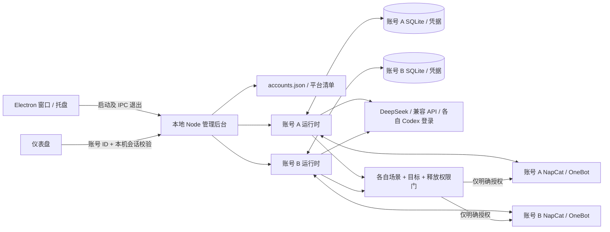

# 功能实现与架构

[返回首页](../README.md) · [使用指南](USAGE.md) · [开发指南](DEVELOPMENT.md) · [接口契约](CONTRACT.md)

v0.4.0 使用一个 Electron 桌面壳和一个本地 Node.js 管理后台，同时运行多个相互隔离的 QQ 配置。每个账号拥有独立的配置、多组 API 凭据、SQLite、QQ 连接、任务队列、NapCat 实例资料及 Codex 登录目录。

NapCat 是 QQ 连接组件，负责实际登录和消息接口；DeepSeek/Codex 负责分析文字；应用自己的后台决定执行什么任务、允许向哪里发送。输入 QQ 号不是登录动作，模型也不直接获得任意 QQ 操作能力。

## 各功能的代码入口

| 功能 | 主要代码 | 实现方式 |
| --- | --- | --- |
| 多账号界面 | [public/index.html](../public/index.html)、[public/app.js](../public/app.js) | 首次仅创建入口，账号展开后显示四部分配置；保留任务参数和群/私聊权限子菜单；按账号保留编辑状态 |
| EXE 与托盘 | [desktop/main.cjs](../desktop/main.cjs)、[desktop/preload.cjs](../desktop/preload.cjs) | 自绘标题栏、窗口控制与关闭偏好、单实例、原生导出、Node 子进程和全部后台生命周期 |
| 账号目录 | [src/accounts.mjs](../src/accounts.mjs) | 稳定账号 ID、资料目录和可用/规划平台注册信息 |
| 账号及 API | [src/server.mjs](../src/server.mjs)、[src/account-service.mjs](../src/account-service.mjs) | 本地请求隔离、账号 ID 路由、各账号异步任务与显式权限释放事务 |
| 配置与迁移 | [src/config.mjs](../src/config.mjs) | schema 2 默认只读、场景依赖校验及 v1 权限精确迁移 |
| 模块安装 | [src/installer.mjs](../src/installer.mjs) | 每账号固定模块动作、独立 Docker 容器/登录卷/端口、独立 Codex 安装与认证 |
| QQ 与任务 | [src/runtime.mjs](../src/runtime.mjs) | OneBot 连接与身份校验、群列表、队列、聊天、汇总、收藏、统一发送门 |
| 模型调用 | [src/providers.mjs](../src/providers.mjs) | DeepSeek 官方 API、多组 OpenAI 兼容 API；受限官方 Codex CLI 子进程 |
| 本地存储 | [src/store.mjs](../src/store.mjs) | 每账号 JSON 草稿/应用配置、AES-GCM 凭据与 SQLite 消息/依据/任务 |

## 账号与消息流程



每个操作的 URL 带稳定账号 ID。切换界面只改变正在编辑和查看的账号，不改变已经开始的模型请求、设备授权、安装任务或结果目标。账号实例各自持有 OneBot socket、队列、冷却计时器和配置 epoch；一个账号撤权或重连不应影响其他账号。

后台在 OneBot 握手调用 `get_login_info`，要求实际登录身份与该账号 `botQQ` 一致。群列表由 `get_group_list` 读取，返回只供选择，不自动生成读取或发送许可。两个账号配置不能共享正在使用的接口。

## 配置引导与实际完成状态

账号控制初始只显示创建入口，展开单个账号后按「账号与 AI、连接 QQ、任务与权限、启动账号」四部分组织参数。保留每个账号的主下拉栏与单选 AI 下拉框；高级模型参数、NapCat 帮助和诊断默认折叠。保存状态及操作放在账号菜单末尾，不再另设状态卡。引导读取该账号实际配置和运行状态，不把安装完成、填写 QQ、保存 Key 或登录 Codex 当成 QQ 已登录。已经完成 NapCat 登录和模型配置的用户，可直接处理尚缺的功能、群或启动授权，无需重复安装。

前端将兼容的 `models`、`scenarios` 步骤分别映射到 `identity`、`permissions`，后端状态接口保持兼容。`GET /api/accounts/:id/setup/status` 返回步骤与阻塞项，同样的 `setup` 数据放入账号 `/state`。连接检查核对实际 OneBot 身份；模型测试是明确发起的真实请求，按配置与凭据指纹记录，通过后若更改模型或 Key 则失效。检查结果不能替代真实群消息/发送验收。

最后“启动此账号”使用既有显式权限释放事务，不新建旁路授权。可选的群发送验证只在已授权可读可发群发送固定诊断文字，不调用 AI；它同样经过场景、账号和目标权限检查。不会为诊断自动扩大群范围。

## 配置、场景与权限

schema 2 保留 `botQQ`、`ownerQQ` 内部字段；界面分别解释为实际接入 QQ，以及可选的私聊操作者/整理接收对象，不再要求一开始区分主号、小号。

新账号默认：

```json
{
  "permissions": { "released": false, "privateReplies": false },
  "chat": { "enabled": false, "provider": "deepseek" },
  "groups": [],
  "summary": { "enabled": false, "sendToOwner": false },
  "favorites": { "enabled": false, "provider": "deepseek" }
}
```

上面仅展示关键字段，完整配置见 [接口契约](CONTRACT.md)。新增群默认 `read: true, send: false`。`mode: work/social` 描述用途，不授予发送能力；工作群默认只读，用户明确设置 `send: true` 并释放权限后，也可按聊天规则触发所选 API 模型。

账号功能参数负责启用聊天、通知和收藏、选择模型和运行参数；另一子菜单负责选定群、读取、发送与可选私聊目标。配置模型或登录 Codex 不更改 `permissions.released`。该字段既控制自动场景授权，也参与所有发送检查；未释放时仅按读取范围记录，不运行自动聊天或定时模型任务，面板明确发起的本地整理和连接测试仍可执行。

任何 QQ 出站都经过统一 `destinationGate`，包含成功结果、错误提示和汇总分片：

1. 任务仍属于当前账号和配置 epoch，连接身份一致。
2. 账号已显式释放，相关场景仍启用。
3. 群目标同时具有读取和发送许可；群自动回复使用已启用的 DeepSeek 或兼容 API，不能使用个人 Codex 订阅。
4. 私聊目标是配置中的本人操作者，且独立允许私聊发送。
5. 汇总来源仍为该账号当前允许读取的工作群。

提示词或 Codex 只读沙箱不替代这层权限。授权由后台固定规则执行，前端不提交任意 OneBot 操作、shell 命令或文件路径。

## 模型路由与账号任务

群消息先判定是否允许读取，仅选定可读消息入库。允许发送、聊天启用且账号已释放后，再按 `group.triggers` 中已勾选的新消息/真实通知条件触发所选 API 模型，并统一检查冷却时间。上下文仅包含当前账号、当前群及用途下的资料，工作通知、收藏与其他群不作为普通群聊上下文。

群触发为多选 OR：`mention`、`prefix`、`casual`、`poke`、`group_name`、`member_join`、`member_leave`、`admin_change`、`mute`、`recall`、`group_card`、`emoji_like`。默认只有 `mention`，空数组禁用自动群回复；旧单值 `trigger` 在规范化时映射到数组，保留原有选择。多选或全选不能越过账号、群读取/发送和场景权限。

`casual` 仅在收到新文本时按概率回复，不设置无人消息时主动说话的定时器。通知从实际 OneBot/NapCat 消息读取；例如群名变化为 `notice/notify/group_name` 携带 `name_new`。通知触发只产生文字回复，不映射成任意 QQ 管理操作。事件边界按 [NapCat 通知实现](https://github.com/NapNeko/NapCatQQ/tree/v4.18.38/packages/napcat-onebot/event/notice) 核对，模拟事件测试不能替代真实 QQ 触发验收。

本人私聊普通文字使用 `chat.provider`，可选择 `deepseek`、`codex` 或 `models.apis` 中某个稳定 API ID，且只要求所选模型可用；`/ds`、`/gpt` 可切换已启用的内置通道。`/summary 群号`、`/favorites` 使用各自模型。这些命令仍需启用相关场景和私聊权限。默认聊天选 Codex 时不运行自动群聊；个人订阅只处理本人明确发起或授权的任务。

`models.apis` 是当前账号的兼容 API 列表，每项包含 `id`、`label`、`enabled`、HTTPS `baseUrl`、`model`、`maxTokens` 和 `temperature`。密钥以 `apiKey:<id>` 独立写入 vault，配置和导出不能包含 Key。同一账号可配置多个 API，聊天、通知和收藏分别绑定一个模型；不会默认把一条消息发给所有 API，也不会在失败时静默换计费通道。

兼容 API 使用 Chat Completions 文字接口，在基础地址后请求 `/chat/completions`，禁用重定向。服务及模型支持情况由实际测试确认，不能仅凭预设名称宣称已联调。DeepSeek 内置通道仍固定到官方地址。

`ownerQQ` 仅约束可选私聊流程。同号本身不妨碍群读取和本地整理；只有启用私聊回复或私聊汇总时，才要求填写不同的 QQ。配置错误以字段路径、原因与修正动作返回，前端在对应位置显示，不把所有问题压成原始数组提示。

Codex 通过官方 `login --device-auth` 登录，每个账号独立 `CODEX_HOME` 和工作目录，`exec` 处理文字。子进程不继承付费 API 凭据；网页历史、记忆和自定义 GPTs 不会带入，失败不静默切换模型或计费通道。推理使用只读沙箱和受限工具配置，拒绝带工具执行事件或未完成的结果；这些限制不等于完整操作系统隔离。

### 通知与收藏

通知汇总读取当前账号选定、可读工作群的缓存，限制条数和文字预算。模型接收消息 ID、发送者、时间和原文，输出通俗解释、行动项、原文期限和引用。程序核对引用 ID，保存证据与送达状态。默认仅本地保存；可在账号与私聊许可均已释放时发送指定本人，不把汇总发回源群。

定时按运行电脑本地时间执行，按账号、群和日期去重，需明确后台授权及释放账号。定时器入口、排队和实际运行时检查释放状态；未释放时不自动调用模型。已释放且 `read:true/send:false` 的群可执行本地整理，不因自动整理获得发送许可。应用退出或休眠时不补跑。

收藏通过 `get_collection_list` 读取实际登录账号的列表摘要，保存 CID、账号、时间和原摘要。整理时核对缓存账号，使用独立的 `favorites.provider`，不复用通知的模型和发送设置。面板整理默认本地保存；本人私聊请求仍走私聊权限门。暂不提供定时收藏、全文、附件、完整分页或跨账号收藏访问。

## 数据与模块隔离

默认根目录继续使用 `%LOCALAPPDATA%\QQBridgeDashboard`：

```text
accounts.json                  账号目录与稳定 ID
accounts/<ID>/config.json      新账号草稿、应用与上一版本
accounts/<ID>/vault.json       新账号加密凭据
accounts/<ID>/vault.key        该账号加密密钥
accounts/<ID>/history.sqlite   消息、收藏、汇总与任务
accounts/<ID>/modules/         NapCat / Codex 与模块安装记录相关资料
accounts/<ID>/codex-home/      官方 CLI 自行管理的独立认证目录
accounts/<ID>/codex-workspace/ 独立文字任务工作目录
```

每账号自己的 `module-state.json` 记录安装结果。Docker 容器名由项目目录稳定标识生成，并核对项目标签；登录卷、OneBot Token、WebUI Token 和端口各自独立，不接管同名的非本项目容器。NapCat 官方镜像固定版本，首次安装记录 RepoDigest 后按摘要启动；进程使用固定 argv 与 `shell: false`。

原生 NapCat 不依赖 Docker，运行时直接连接其本机 OneBot；应用安装按钮仍只管理 Docker。原生多账号实例和 QQ 登录资料由用户按上游说明准备、启动及备份，见 [原生指南](NATIVE_NAPCAT_WINDOWS.md)。

AES-GCM 避免配置与导出出现明文凭据，密钥同目录，因此不隔离拥有同一操作系统目录访问权的用户。Codex 认证文件由官方 CLI 管理，仪表盘不读取。日志与任务带明确账号标识，并对所有账号的凭据脱敏。

## 迁移与配置生命周期

旧版单账号成为兼容 profile，继续使用原根目录、NapCat 卷和容器、Codex 登录目录，不移动会话资料。`migrateConfig` 对明确的 schema 1 文档迁移草稿、应用与上一版本，保留 revision；原文件备份为 `config.v1.backup.json`，重复启动不再次迁移。

旧社交群已有的发送能力、本人私聊能力按原配置映射；旧工作群 `send: false`，不扩大旧授权。新建 profile 一律从只读默认值开始。

保存只写该账号草稿和待应用凭据。普通应用或回滚更新配置并回到只读；只有 `/permissions/release` 校验当前保存 revision 后，才能设置 `released: true`。撤销即时禁止发送并取消旧任务。API 输入不能通过普通保存伪造释放状态。

配置应用失败恢复原配置和凭据并尝试恢复该账号运行时。第三方登录和网络状态异步显示，连接失败不伪造成功。已发生的外部发送无法回滚。

## 桌面与构建

Electron 使用无原生边框窗口，页面绘制标题区和最小化、最大化/还原、关闭按钮；总览业务内容保持原有结构。原生菜单栏移除，导出仍在应用内提供。设置页可选择关闭后进入托盘或完全退出。

Electron 渲染层关闭 Node integration，启用 context isolation 与 sandbox，只访问本次后台的同源资源。预加载暴露经过限定的窗口操作、关闭偏好与固定导出接口，主进程验证请求来源；导出携带 profile ID，主进程使用对应账号的固定 API。官方授权链接和本机 NapCat 页面交给默认浏览器。

后台由附带的 Node 24 子进程运行。完全退出或父 IPC 断开时关闭所有账号运行时和安装子进程，超时只清理本应用拥有的后台进程树。桌面壳放在 ASAR，Node/npm 与后台放在独立 resources；构建不包含用户资料。

## 平台扩展与验证范围

当前平台注册 QQ 为已实现，微信与 Telegram 为规划项；不能仅选择平台名称就使用。将来需增加真实连接、身份、消息、来源读取和受控发送适配器，并继续使用账号、会话、用途与权限门约束。AstrBot 也未作为本版必装依赖。

自动测试使用模拟 OneBot 和模型。v0.2.1 已有 Windows CI 发布记录，本版结果以 [验证记录](VALIDATION.md) 为准；真实 QQ 扫码、真实模型账号以及 Windows 桌面、Docker Desktop/原生多账号操作仍需实际验收，不用协议模拟冒充账号联调。
