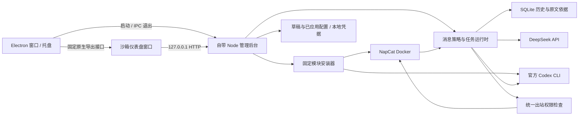

# 架构与扩展



`src/server.mjs` 管理 HTTP 接口、请求保护、异步安装任务、配置应用及恢复。`src/config.mjs` 校验统一配置。`src/store.mjs` 保管凭据、消息和依据。`src/installer.mjs` 管理外部模块、固定版本与本机 Docker。`src/runtime.mjs` 负责 OneBot、用途策略、队列、定时汇总和发送；`src/providers.mjs` 封装模型调用。

`desktop/main.cjs` 管理单实例、窗口、托盘、原生菜单与后台生命周期；后台用独立 Node 24 运行，避免依赖 Electron 内置 Node 的 SQLite 支持。`desktop/preload.cjs` 只暴露桌面标识、版本和脱敏配置导出；渲染层关闭 Node integration，启用 context isolation 与 sandbox。页面导航和资源仅允许本次后台地址，官方授权外链交给默认浏览器。后台收到 IPC 退出或父连接断开时清理运行时和安装子进程；超时仅强制清理本应用的后台进程树。

`scripts/prepare-windows.mjs` 校验官方 Windows Node ZIP，再将生产后台、固定依赖与运行环境放到构建暂存目录。`electron-builder.yml` 将桌面壳打进 ASAR、Node/backend 作为独立 resources，生成便携 EXE。用户资料始终在 LocalAppData，而非便携展开目录。

首版选择内置轻量运行时，统一控制消息发送与模型路由。AstrBot 没有作为必装依赖。后续可以使用它的 [公开 HTTP API](https://github.com/AstrBotDevs/AstrBot/blob/v4.28.2/docs/zh/dev/openapi.md) 加入配置档与插件管理适配器；接入时仍需确保所有发送经过统一网关，不能只依赖提示词或关闭 LLM 的配置。

## 必须保持的约束

1. 社交群只能调用 DeepSeek；GPT 订阅只有本人私聊、本人明确发起或授权的汇总可以使用。
2. 工作群和未选定群不能成为出站目标。即使任务发生错误，也不能把错误提示发到工作群。
3. 工作、收藏与社交聊天上下文分开；新平台也必须按账号、会话和用途过滤资料。
4. 运行中的旧模型任务在配置变更时取消；发送前按最新配置再次校验目标。
5. 前端不能提交任意 shell 命令、任意下载源、任意文件路径或直接拿到 OneBot/API 凭据。
6. 安装、服务运行、账号登录、模型连通是四种不同状态，分别显示。

## 后续增加模块

安装器当前的模块目录定义包括 `id/name/kind/description`，外部模块另有固定版本、官方地址、持久目录和状态检查。增加一个模块需要实现对应固定动作与检查方法，不能把输入命令交给 shell。

建议第二版把目录提取为模块 manifest，再实现安装任务的持久化、取消和显式更新/卸载。第一版不会静默更新上游镜像或执行任意第三方插件。

## 后续增加应用

第一版只支持一个 QQ 小号。未来新增 Telegram、飞书等适配器时，先将 OneBot 接收/操作从 `runtime.mjs` 提取为平台接口：

```text
Adapter.connect() / disconnect() / identity()
Adapter.onMessage -> {platform,accountId,sessionId,messageId,userId,time,text}
Adapter.send(destination,text)   // 只由权限网关调用
Adapter.readSources(options)    // 能力明确标注，不假定各平台都有收藏/历史
```

工作流继续引用统一的消息、来源与模型接口。数据库已有账号、群、消息、用户和时间元数据；多平台接入前需增加 platform/sessionId 并迁移唯一键。现阶段不宣称可以无需改代码安装任意平台。

## 配置应用语义

保存只写草稿和待应用凭据；应用进行依赖校验，再切换运行配置。配置或 OneBot Token、端口、机器人账号发生变化时重载相应部分。后台记录上一份普通配置；应用抛错时恢复配置与凭据并尝试恢复运行时。

账号是否登录以及第三方网络是否可用异步显示，连接失败不伪造成功，也不因临时网络失败丢弃用户已应用的参数。模块安装失败保留可诊断信息，已下载的独立模块保留，用户可重试。第一版不是跨文件系统、Docker 和远端账号的分布式事务；已发生的外部发送无法回滚。

## 验证边界

自动测试覆盖最重要的权限和配置语义，使用本地模拟 OneBot 与模型。Windows PowerShell 启动、Docker Desktop 文件挂载、真实 QQ 扫码、上游镜像下载、Codex 设备码认证与模型权限仍需在用户的 Windows 电脑完成最终验收。
