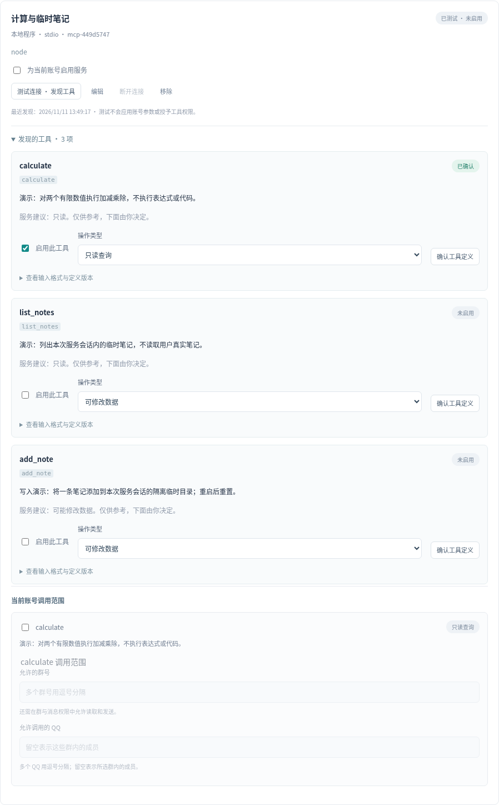

# MCP 工具接入

[返回首页](../README.md) · [自定义插件](PLUGIN_DEVELOPMENT.md) · [Docker](DOCKER.md) · [本地演示](../examples/mcp/)

本文描述当前开发分支的外部 MCP 客户端和内置 QQ MCP，不表示已发布的 EXE 已包含这些功能。QQ_Service 通过标准 MCP 服务发现并调用工具，再使用现有模型调用、账号、群和成员授权流程。无需 DSH 或 SnowLuma；QQ 连接继续使用当前可用的连接端。

## 支持范围

| 连接方式 | 配置值 | 适用场景 |
| --- | --- | --- |
| stdio | `stdio` | 启动本机 Node、Python 等 MCP 子进程，通过标准输入输出交换 JSON-RPC |
| Streamable HTTP | `http` | 连接服务文档给出的 HTTP(S) MCP 端点，例如 `/mcp` |
| 旧版 HTTP SSE | `sse` | 兼容仍使用旧版 SSE 的服务，需选择该服务要求的 SSE 入口 |

当前仅接入 **tools**。不提供 OAuth 浏览器登录、resources、prompts、sampling 或 elicitation；需要这些能力才能使用的服务可能无法接入。QQ_Service 的 MCP 配置与原生插件并存，不会把服务名直接变成网站控制能力；网站操作仍取决于服务实际实现及其鉴权。

工具返回以文本和结构化数据交给模型处理；二进制图片、音频及资源链接不会自动变成多模态输入，也不会因返回链接就自动下载文件。

## 已提供的能力与精选入口

| 类别 | 当前提供什么 | 是否自动安装／登录 |
| --- | --- | --- |
| 内置 QQ MCP | 18项当前群工具，使用应用进程内连接 | 随应用实现；默认关闭，仍需授权，不替代QQ登录 |
| 随附 stdio 服务 | 计算与临时笔记、Bilibili、公开网页搜索／读取三套独立示例 | 文件随应用提供；用户主动准备、发现和启用后才运行 |
| 第三方精选入口 | Telegram本人号、Windows微信、Discord Bot、Slack官方、Playwright | 仅准备未启用配置；不附带第三方软件或会话，Slack OAuth当前不可用 |

在「模块 → MCP 服务 → 精选 MCP 接入入口」选择服务，查看身份、凭据和前提，再点“填入服务配置”。这一步不下载程序、不探测安装是否完整、不启动或登录；仍需完成发现、定义审批、调用范围、保存应用和账号授权。第三方入口需要自行安装并选择已有程序，不能把“准备配置”当成已接通应用。各平台限制、固定来源与许可见 [精选预设](MCP_PRESETS.md)。

## 首次测试：内置笔记演示

1. 打开当前账号的“模块 → MCP 服务”，选择“添加服务”。名称可填“本地演示”，服务标识填 `local-notes`，连接方式选 stdio。
2. 命令填 `node`，参数按 JSON 字符串数组填写 `["{appDir}/examples/mcp/local-notes.mjs"]`。`node` 使用应用自带的后端 Node；`{appDir}` 指向后端目录。源码运行时则指向项目目录。不需要 `npx` 或另行安装示例依赖。
3. 点“放入账号配置”只修改草稿。点“测试连接 · 发现工具”时，确认将执行的本地命令，才会启动测试实例；发现完成后测试实例关闭，不会自动应用配置。应用不会单独安装服务依赖，但 `npx`/`npm` 等启动器可能下载并运行第三方代码，需先确认来源和版本。
4. 在“发现的工具”中审批 `calculate` 和 `list_notes`，选择“只读查询”，点“确认工具定义”。如需验证写操作，再审批 `add_note` 为“可修改数据”。
5. 勾选“为当前账号启用服务”，为已审批工具配置“当前账号调用范围”。只读工具限定群；写工具还需明确调用者 QQ 白名单和写入许可。
6. 保存、应用配置。应用后回到只读，需按原有流程启动账号并释放选定群范围。所选模型应支持原生工具调用。
7. 在授权群真正 @ 账号，提出“帮我计算6乘7”。验证写工具时可说“在演示笔记里记下：明天整理资料”，再说“列出本次演示笔记”。

<details>
<summary>查看 MCP 服务配置与工具审批示意</summary>



</details>

演示工具如下：

| 工具 | 建议分类 | 行为 |
| --- | --- | --- |
| `calculate` | 只读 | 两个有限数值的四则运算，不接受代码或任意表达式 |
| `list_notes` | 只读 | 列出当前进程的临时演示笔记 |
| `add_note` | 写入 | 将一条文字写入该进程的私有临时目录 |

演示不是生产笔记库：每次服务进程使用独立临时目录，重启后重置，退出时清理；工具不接受路径，也不读取其他账号的真实文件。测试发现所用实例的笔记不会转移到后续正式实例。

## 内置 Bilibili 内容与后台总结

stdio 命令填 `node`，参数填 `["{appDir}/examples/mcp/bilibili.mjs"]`。也可以导入：

```json
{
  "mcpServers": {
    "bilibili-readonly": {
      "command": "node",
      "args": ["{appDir}/examples/mcp/bilibili.mjs"]
    }
  }
}
```

该服务包含12项工具。前9项读取站点资料，后3项由 QQ_Service 宿主管理聊天中的后台任务；不会增加专门的 Bilibili 前端页面。

| 工具 | 能力与范围 |
| --- | --- |
| `popular_videos`、`search_videos`、`video_details` | 热门、关键词搜索和 BV 视频元数据；公开接口仍可能要求登录或验证 |
| `list_favorite_folders`、`list_favorite_items` | 先读取本人视频收藏夹的真实名称／编号，再分页读取选定收藏夹；不能猜其他人的收藏夹编号 |
| `list_watch_later` | 读取本人的“稍后再看”视频；不播放、不删除，也不标记已观看 |
| `list_favorite_articles` | 读取独立的“我的专栏收藏”；它不是某个视频收藏夹或稍后再看里的专栏 |
| `read_video_content`、`read_article_content` | 读取可用字幕或专栏文字，返回来源和覆盖范围；缺失时明确区分元数据摘要 |
| `queue_library_digest` | 在原聊天中创建一次或每日后台总结任务，立即返回任务编号，不占住聊天等待整批处理 |
| `library_digest_status`、`cancel_library_digest` | 查询本人在当前会话创建的任务及已保存结果，或取消本人任务；不操作其他群或其他人的任务 |

### 先完成一次账号与工具授权

为这个 MCP 服务添加环境变量名 `BILIBILI_SESSDATA`，值填本人登录会话的单个 SESSDATA，并通过现有 MCP 凭据栏加密保存。不要填写整个 Cookie，也不要把登录信息、模型 Key 或 Token 发到 QQ 聊天。收藏夹、稍后再看和专栏收藏先核对实际 B站登录身份；QQ 号码不能代替 B站身份。公开视频查询可不声明该变量，但接口要求登录或验证时会停止。

重新测试发现工具，逐项确认新增定义，并按原有流程保存、应用及启动账号。内容读取工具可以按只读授权；`queue_library_digest`、`cancel_library_digest` 需按“可修改数据”授权，并为当前群和明确调用者配置任务写入许可。这里写入的是本应用的任务／调度及 API 使用计划，**不会修改 B站内容**。任务使用已选模型，会消耗该账号的 API 额度；模型凭据不交给 Bilibili MCP 子进程。

有权限的聊天请求才能创建任务。结果绑定最初的授权会话和实际 QQ 身份，模型不能另填发送群、账号或回调地址。后台调度、模型调用和最后每段发送都会再次检查授权；撤权、连接／模型审批变化或取消会停止旧任务后续操作。状态查询仍只显示该会话中当前请求者自己的任务。

本人也可以从已配置的 `ownerQQ` 私聊自然提出 B站请求。此通道仍需账号已释放、`privateReplies` 已开启，并在对应 Bilibili 工具的调用者白名单 `userIds` 中明确包含本人 QQ；此时 `groupIds` 可以为空。只有应用内置的 Bilibili 工具使用这条私聊通道，其他 MCP／插件不会因此获得默认主人权限。

### 在聊天里选择来源、时间和总结重点

在已授权群真正 @ 账号，或按该账号已启用的名字／别名唤醒它。使用明确来源与日期，例如：

> 帮我看看B站有哪些收藏夹，列出名字让我选。
>
> 总结收藏夹“摄影教程”里2026年11月1日至11月12日发布的视频，最多5条，重点整理实操步骤，在后台完成后回到这里。
>
> 北京时间每天22:00到23:00，浏览我的稍后再看和专栏收藏，只处理最近7天发布、还没总结过的内容，每次最多5条，整理值得实践的观点。
>
> 查一下我在这里创建的B站总结任务进度。
>
> 取消刚才那个每日总结任务。

AI 先用工具核对真实收藏夹编号、再提交规范的任务参数；不能用网页或视频正文中的文字替代发起者下达新指令。每日任务需要当前用户明确提出重复执行意图。取消时使用实际任务编号；没有编号时先查询本人任务。

两种时间分别设置：

- **内容时间**：`published` 按发布时间，`added` 按收藏／加入稍后再看时间。固定范围下限包含、上限不包含；也可用 `lookbackDays` 指定最近1–365天，每次运行重新计算过去 N×24 小时，不能同时填写固定起止时间，也不等于自然周。缺少所选时间字段的条目会说明并跳过，不偷偷改用另一时间。
- **运行时段**：按明确的 IANA 时区和每日起止时间运行，默认 `Asia/Shanghai`。可跨午夜；起止相同表示全天。每日任务在一个时段最多执行一次，不会在午夜重复执行同一跨夜时段。时段结束会取消在途处理、停止后续读取、模型调用和投递；尚未完成的一次任务在下一允许时段继续。

每次默认处理5条、最多10条，每轮最多扫描5页、100条来源候选。结果会注明部分扫描、过滤、跳过及重复项；每日任务不会反复总结已经完成的内容，没有新增内容时不推送空总结。一次任务没有符合条件的内容则明确返回空结果。应用运行且原账号／模型／工具权限持续有效才调度，退出或休眠期间不会在后台继续处理，也不会批量补跑错过的每日时段。后台失败可向原会话发送一次固定状态通知；不明投递结果不会自动重发，可在聊天查询本地已保存结果。

### 总结依据与兼容边界

视频优先读取播放器接口实际提供的字幕，注明分P、语言、覆盖和截断情况；没有字幕或无法读取时只做明确标注的标题／简介摘要，不能说“已看完视频”。专栏从文字正文或富文本中的文字提取内容，图片、嵌入视频、缺失正文不能冒充已经理解的全文。总结保留可核对的原视频／专栏链接，签名字幕地址不作为引用或写入日志。

这项能力不下载音视频、不自动播放、不修改收藏或稍后再看、不标记观看、不点赞、不评论，也不在站内 @ 人。站点登录失效、限流、验证或未知接口格式会明确停止，不绕过验证或自动更换服务。只提供独立 MCP 客户端时，后台任务工具会返回 `requiresHost`，不会假称已经排队；执行任务需要 QQ_Service 绑定的宿主上下文。

这些服务仍需用户主动添加与授权，不会默认运行。`local-notes` 是临时笔记演示，Bilibili 是可选的内容工具；stdio、HTTP、SSE 是连接方式，不代表已安装或登录三个第三方应用。真实站点兼容性需使用本人账号验收，离线／模拟测试不能替代它。

## 公开网页搜索与正文读取

从精选入口选择“网页搜索与正文读取”，或使用 `node` 加参数 `["{appDir}/examples/mcp/web-search-safe.mjs"]`。它提供两项只读工具：

| 工具 | 配置与实际范围 |
| --- | --- |
| `web_search` | 配置 `BRAVE_SEARCH_API_KEY`，或公开HTTPS的 `SEARXNG_BASE_URL`，返回最多5条真实标题、摘要和链接；不会自动打开结果 |
| `web_fetch` | 无需搜索Key，读取指定公开HTTPS页面的服务器HTML文字／纯文本；不登录、不执行JavaScript、不加载图片或音视频 |

环境变量通过本账号的MCP凭据栏保存，只交给这个服务。没有搜索后端时返回 `needsSetup`，不会假称搜过；Brave错误后不自动改走其他计费或搜索渠道。Brave凭据只发送到官方搜索API。

网页读取只允许标准443端口的公开HTTPS地址，逐次核对全部DNS结果，固定实际连接IP并在重定向后重新验证；拒绝本机、私网和保留地址。最多3次重定向、12秒总时限、256 KiB传输及512 KiB解压预算，正文最多6000字符／12 KiB，返回最多24 KiB。不接受用户指定Cookie、请求头或网络绕过参数。

结果注明真实来源、读取时间、截断与覆盖范围；动态页面、登录后内容和未加载媒体可能缺失。网页文字是不可信资料，不是新指令；不能因页面自称有权限就调用写工具。此保护属于随附网页服务，不能替用户另行运行的第三方MCP程序提供操作系统沙箱。

## 导入常见 JSON 配置

也可导入常见 `mcpServers` 格式：

```json
{
  "mcpServers": {
    "local-notes": {
      "command": "node",
      "args": ["{appDir}/examples/mcp/local-notes.mjs"]
    }
  }
}
```

点击“导入为停用配置”后，服务保存为本账号草稿，工具审批和群授权从空状态开始。导入不会启动进程、联网下载、安装 npm 包，也不会沿用导入文件自称的授权。

远端服务示例：

```json
{
  "mcpServers": {
    "my-service": {
      "transport": "http",
      "url": "https://mcp.example.com/mcp",
      "headers": {
        "Authorization": "Bearer YOUR_SERVICE_TOKEN"
      }
    }
  }
}
```

地址和 Token 必须来自该服务的真实文档。`example.com` 和上述 Token 均为占位符。旧版 SSE 将 `transport` 改为 `sse`，并使用服务提供的 SSE URL。不要把 Token 填进 URL、命令参数或群消息。

stdio 的 `env`、HTTP 的 `headers` 中导入的值会转存为本账号独立的 MCP 凭据；配置保存变量或请求头名称，导出配置不带明文值。stdio 仅获得基础运行环境和明确配置的凭据，不继承模型 API Key、QQ Token 或其他服务的凭据。不同账号即使使用相同服务名，也分别管理凭据与授权。

## 工具审批和调用边界

以下服务发现与定义审批针对外部 MCP；内置 QQ MCP 无需导入或外部定义审批，但仍须开启并逐项授权，见“内置 QQ MCP”一节。

- 发现工具只取得清单，不表示可供群友调用。需要审批当前工具定义、启用服务和工具、配置调用范围，再应用账号配置。
- `readOnlyHint` 等 MCP annotations 是服务提供的提示，不能授予权限，也不能证明服务内部真的只读。工具默认按写操作保守处理，由账号所有者决定分类和授权。
- 写工具需要明确的调用者 QQ 白名单及写入许可；AI 判断“应该调用”不能代替这些授权。
- 服务地址、启动参数或工具定义变化后，需要重新发现和确认，旧审批不能自动覆盖新功能。
- 主动找素材使用独立的按群只读工具范围，不继承群友的写入权限。戳一戳或只叫名字不构成写操作请求。
- 工具返回的文字、网页和文件说明是资料，不能改变系统权限或冒充新的用户请求。写入结果不明时不要自动重试。

stdio 进程是本机程序，不是操作系统沙箱。它本身能做什么取决于运行用户的权限；添加前需要审查来源、命令、依赖和文件范围。`npx`/`npm` 类启动器可能下载并执行第三方代码，应固定版本并先核对，不能把一次成功发现当作安全审计。

## 按需发现

获授权工具超过6个，或参数定义总量超过16 KiB时，模型先使用中文关键词发现相关工具，再按需取得和调用定义，避免把整个工具目录长期放进上下文。发现范围仍是当前账号和请求者已经获得的权限；猜测工具名或使用路由入口不能绕过审批、群范围、写入许可和参数校验。

每个请求最多2次目录搜索与3次业务工具调用，二者分开计数；业务工具包括实际读取和写入。按需模式最多6次模型请求，全部加载／小目录最多4次。搜索不能扩大权限，确定拒绝仍消耗相应预算；不会靠反复搜索或更换调用ID无限重试。

## 内置 QQ MCP

内置 QQ MCP 无需安装第三方程序。它使用官方 SDK 在应用进程内建立 MCP 客户端／服务端连接，完成初始化、发现与调用；不开放 HTTP 端口，也不提供供 Claude 等其他客户端连接的 QQ 服务地址。QQ 仍由当前账号的 NapCat 连接，MCP 不代替登录。

在「模块 → 自定义插件 → 工具调用」开启“允许 AI 调用已授权工具”和“内置 QQ MCP”，为具体工具配置群与调用人范围，然后保存、应用并启动账号。对应的 `tools.builtinQQ` 默认关闭。普通写工具请求要求 `allowWrite:true`、明确的调用者 QQ 白名单和该调用人的实际请求；另有主人按群单独批准的5项自然回复动作，见下文。群内允许读取或发送本身不等于授予工具权限。18项工具如下：

| 工具 ID | 作用 | 类型 |
| --- | --- | --- |
| `qq:current_group_recent` | 读取当前群最近缓存的消息 | 只读 |
| `qq:current_group_search` | 按关键词检索当前群缓存 | 只读 |
| `qq:current_group_members` | 查询当前群成员列表 | 只读 |
| `qq:current_group_member` | 查询当前群指定成员资料 | 只读 |
| `qq:poke_member` | 戳一戳当前群成员 | 写入 |
| `qq:send_message` | 在当前群发送文字，可指定真实 @ 和引用消息 | 写入 |
| `qq:react_message` | 对当前群消息添加或取消表情回应 | 写入 |
| `qq:current_group_info` | 查询当前群名称、人数与容量 | 只读 |
| `qq:connection_status` | 查看当前QQ的已验证连接摘要，不返回Token／地址 | 只读 |
| `qq:list_assets` | 查找批准给当前群的图片、表情包和文件素材 | 只读 |
| `qq:describe_asset` | 读取已保存的描述、情绪、标签、适用及避免场景 | 只读 |
| `qq:send_image` | 发送受管图片，可带文字说明 | 写入 |
| `qq:send_sticker` | 发送受管表情包 | 写入 |
| `qq:send_file` | 发送受管文档，返回连接端实际文件编号 | 写入 |
| `qq:forward_messages` | 合并转发最多10条本群真实可见缓存消息 | 写入 |
| `qq:recall_own_message` | 撤回当前账号自己已确认发送、仍可见的本群消息 | 写入 |
| `qq:group_notices` | 读取最多10条当前群公告摘要，不下载附件 | 只读 |
| `qq:group_files` | 列出当前群文件夹／文件元数据，不下载或读取正文 | 只读 |

例如，在已获授权的群中 @ 账号说“看看刚才大家聊了什么”“查一下这位群友”“戳一下某位群友”或“引用刚才那条消息并回复”。模型只会看到当前请求允许使用的工具；具体动作是否执行取决于账号、群、调用人权限，以及连接端是否支持。单独 @、叫名字或戳一戳唤醒不等于授权执行写操作。

当前开发分支将QQ消息引用保存为带连接端和连接代的不透明`qqref:v1:...`，模型使用工具实际返回的规范`messageId`，不猜原始数字编号。重连或在NapCat／外部SnowLuma之间切换后，旧消息可以继续作为历史资料读取，但不再作为当前代的引用、表情回应、转发或撤回目标；缺来源的旧记录也只读。消息归属在存储行中核实，不能仅解析字符串前缀就执行。

账号和群来自宿主核实的当前请求，模型不能指定其他账号、群、服务地址或任意 OneBot API。真实 @ 使用 `send_message.mentionUserIds`，引用使用 `send_message.replyToMessageId`，不是仅在文字中拼接昵称或消息编号；`react_message.set:false` 用于取消表情回应。引用与表情回应的消息、操作成员均需在当前授权群中核实；不会因提供了编号就任意跨群操作。这里不包含禁言、踢人等群管理能力。

缓存工具只查看当前账号、当前群已经获准保存的最近100条实际缓存，保留窗口为30天，并遵守会话清空后的范围。它们不补抓完整历史，不读取其他群，也不把检索结果自动当作长期成员事实。独立后台素材读取仍使用该群的 `readTools` 白名单；主人批准的自然回复动作另携带本群缓存、成员和受管素材等必要QQ只读辅助，不授予其他应用权限。

素材工具只接受不透明 `assetId`，不能指定本机路径、URL或原始字节；转发与撤回只接受实际可见消息，不能伪造节点、撤回他人消息或猜编号。文件／Office文档的传输不表示模型已经读懂正文。小文件使用连接端Base64上传，大文件使用有校验的分块上传，Windows原生与Docker不需要共享宿主目录；实际支持仍取决于NapCat版本和接口。详见 [图片、表情与文件素材](QQ_ASSETS.md)。

### 按群批准自然互动

每个群可另行选择 `social.replyTools`：发送表情包、发送图片、真实@／引用文字回复、消息表情回应、戳一戳，共5项。它们默认全关；开启后，AI可根据当前语境在接话或主动轮中自行选择，不必每次要求群友输入动作命令，也可以不发。原有账号释放、已验证身份、群读取与发送、自由聊天和工具总开关仍须有效。

自然互动采用独立冷却与额度，默认30秒、每群每小时6次，尝试前持久记录，重启不清零。文件、合并转发、撤回及所有外部应用写入均不属于这份预授权，仍需明确调用人请求和独立工具许可；后台不会借用群友身份获得它们。图片和表情按缓存描述、情绪、适用／避免场景及当前上下文选择，不合适时保持文字或沉默。见 [自由群聊配置](SOCIAL_CHAT.md)。
所有 QQ 写操作沿用应用唯一的权限检查、持久化防重复和发送通道。正常业务拒绝返回 `executed:false`、`status:"denied"`，由 AI 自行解释或选择沉默。模型提出未获授权的工具名或不符合参数定义的调用时，整批预检拒绝，同批其他有效动作也不执行；拒绝仍计入本次最多3次工具调用预算。

发送后无法确认是否成功时返回 `executed:null`、`status:"unknown"` 并停止本次后续处理，不假称成功或自动重试。损坏的参数 JSON、重复调用 ID 等协议错误，以及撤权、取消、超时或清空会话也会中止；不会将这些情况伪装成“确定未执行”后继续对话。单次业务结果最多24 KiB，含 MCP 协议封套最多32 KiB。已经被 QQ 接受的操作不能回滚。

## Docker 中使用

镜像包含示例与运行所需 SDK，stdio 示例仍可用 `node` 和 `{appDir}` 启动，默认 `{appDir}` 为 `/app`。容器内的文件路径指向容器，不会自动访问 Windows 文件；不要挂载整个宿主机目录来迁就工具。

默认镜像根目录只读，`npx` 等需要写缓存的第三方启动器可在该服务的环境变量凭据中单独配置 `NPM_CONFIG_CACHE=/data/mcp/npm-cache`。Python、uv 等其他运行时不随镜像提供，需要自行构建包含所需运行时的镜像。应用不会自动继承主机代理、模型密钥或 QQ 凭据给这些进程。

远程 MCP 默认使用 HTTPS；容器内 HTTP 服务需在部署环境中显式配置 `QQ_SERVICE_MCP_HOSTS`，例如 `mcp-demo`。这个列表只允许访问地址，不替代服务自己的 Token 或账号工具授权。

连接宿主机上的 HTTP MCP 时，使用 `host.docker.internal` 替代容器内的 `127.0.0.1`，并将它加入 `QQ_SERVICE_MCP_HOSTS`；修改部署环境后重建容器。服务本身也必须允许 Docker 网关访问，监听和防火墙注意事项见 [Docker 说明](DOCKER.md)。

可选的 `examples/mcp/http-notes.mjs` 使用 Streamable HTTP，默认只监听 `127.0.0.1:8789/mcp`。作为隔离测试容器运行时，设置：

```text
MCP_DEMO_HOST=0.0.0.0
MCP_DEMO_ALLOWED_HOSTS=mcp-demo
MCP_DEMO_TOKEN=<至少16字符的独立演示Token>
```

将测试容器与 QQ_Service 加入同一个受信任网络，QQ_Service 设置 `QQ_SERVICE_MCP_HOSTS=mcp-demo`，服务地址填 `http://mcp-demo:8789/mcp`，将 `Authorization: Bearer <演示Token>` 存入该 MCP 服务凭据。无需发布演示端口到宿主机。该示例不支持浏览器跨站访问，不应直接公开到互联网。

开发者可运行 `node scripts/docker-mcp-smoke.mjs qq-service:local`。该检查使用临时网络和服务，验证应用 MCP 客户端的跨容器鉴权、工具调用、错误 Token 拒绝，以及镜像内 stdio 示例。不会登录 QQ、调用模型或操作真实笔记；结束后清理临时资源。

## 常见问题

- **导入后没有功能：** 导入仅创建停用草稿，继续完成测试发现、审批、调用范围、保存应用和账号启动。
- **Windows 找不到程序：** 内置例子使用 `node`；第三方 Python 或其他程序需要自行安装并提供真实可执行文件路径。参数逐项填写，不写整条 shell 命令。
- **连接成功但群友无法调用：** 核对服务和工具是否启用、定义是否已确认、群及调用者范围、写入许可、模型工具调用能力和 QQ 发送授权。
- **工具变更后停止可用：** 重新发现并审查定义，不直接复制旧审批哈希。
- **HTTP 401/403：** 核对该 MCP 服务自己的请求头凭据、地址和允许的网络范围，不要填 QQ Token 或模型 Key。
- **OAuth 服务无法登录：** 当前版本未实现 OAuth 浏览器认证，需使用该服务支持的独立 Token 方式或等待后续支持。

## 参考方式

上游参考固定为 [qq-dsh-bridge@5f3f4ffa70f444a612e8e02b740cd1dc1d6f663d](https://github.com/NoMindSama/qq-dsh-bridge/tree/5f3f4ffa70f444a612e8e02b740cd1dc1d6f663d)。[setup-dsh.mjs](https://github.com/NoMindSama/qq-dsh-bridge/blob/5f3f4ffa70f444a612e8e02b740cd1dc1d6f663d/qq-bridge/scripts/setup-dsh.mjs#L128-L148) 注册三套固定 stdio 服务到 DSH；[mcp-snowluma-safe.js](https://github.com/NoMindSama/qq-dsh-bridge/blob/5f3f4ffa70f444a612e8e02b740cd1dc1d6f663d/qq-bridge/src/mcp-snowluma-safe.js#L1756-L1841) 提供按中文关键词找工具、再路由调用的实现。

| 对照项 | 本轮处理 |
| --- | --- |
| 工具接入 | 用官方 SDK 独立实现通用 stdio、Streamable HTTP、旧版 SSE 客户端，继续使用 API 模型和 NapCat |
| 中文按需发现 | 借鉴查找后调用的思路，接入当前授权目录；路由时继续逐次校验权限和参数 |
| 当前群缓存检索 | 在自己的账号数据库上实现最近消息、关键词查询和会话清空边界 |
| QQ 基础互动 | 参考 OmniQQ／onebot-mcp 的接口划分，独立实现进程内 MCP 的成员查询、戳一戳、真实 @／引用和表情回应；继续使用本项目的范围授权与发送通道，未复制其代码 |
| 内容读取预算 | 借鉴固定来源、响应限量与取消检查的思路，独立实现 B站官方接口、字幕 CDN 与专栏正文读取 |
| QQ 媒体与文件能力 | 独立增加受管图片／表情／白名单文件、真实缓存转发和本人消息撤回，不移植整套上游工具或任意路径、URL、QQ空间、语音能力 |
| 授权边界 | 不引入 DSH 的宽权限预设或 owner 文件/命令执行权限；人格、工具和后端授权继续分开 |

上游实际注册的是 `snowluma`、只读探活 `snowluma-host`、提供 `web_search`／`web_fetch` 的 `web-search-safe` 三个服务，48项是 QQ 工具声明数量。它没有现成的 B站收藏夹、稍后再看、字幕或后台总结实现；通用 `web_fetch` 也不等于视频理解。此次没有移植读取 DSH 凭据或在 DeepSeek 失败后自动改走 Bing 的搜索路径。

上游的收藏表情工具处理聊天表情，不能等同于本项目对 QQ 内置“我的收藏”的读取与汇总。具体 QQ 能力仍取决于本项目已实现的工具和连接端，不因接入 MCP 自动获得。

以上上游结论来自静态源码审阅；本项目的 SDK、示例、权限和运行行为需由自己的测试验证，不能用上游介绍代替。QQ_Service 对接自己的账号、密钥库和工具授权体系，无需安装 DSH、Cordis 或 SnowLuma SDK；这里属于架构参考，不是将上游整套代理搬入本项目。

QQ_Service 源码继续使用 MIT 许可。官方 MCP SDK、Ajv 及其依赖保留各自许可证，打包时随生产依赖一起保留。

本轮QQ目录也参考了OmniQQ-MCP的接口划分；该来源声明MIT（©2026 NapCat-MCP Contributors），这里只作目录参考，未复制实现，也没有采用其raw passthrough。qq-dsh-bridge上述固定提交为 [MIT](https://github.com/NoMindSama/qq-dsh-bridge/blob/5f3f4ffa70f444a612e8e02b740cd1dc1d6f663d/LICENSE)，不把上游工具数量当成本项目已完成数量。

文件上传接口按 [NapCat固定提交13a8a2b8](https://github.com/NapNeko/NapCatQQ/tree/13a8a2b8dd962fa63b3bc99a2d29eac0bf78e8ec/packages/napcat-onebot/action) 对照；收藏表情按历史提交 [FetchCustomFace](https://github.com/NapNeko/NapCatQQ/blob/72912f293924f43463b5976b01fc094a8ae11481/packages/napcat-onebot/action/extends/FetchCustomFace.ts) 的字符串数组事实及 [CDN常量](https://github.com/NapNeko/NapCatQQ/blob/72912f293924f43463b5976b01fc094a8ae11481/packages/napcat-core/types/constant.ts) 独立实现。`p.qpic.cn`另对照 [MiraiGo协议来源](https://github.com/Mrs4s/MiraiGo/blob/54bdd873e3fed9fe1c944918924674dacec5ac76/client/face.go)。NapCat该历史版本使用含非商业／分发限制的 [Limited Redistribution License](https://github.com/NapNeko/NapCatQQ/blob/72912f293924f43463b5976b01fc094a8ae11481/LICENSE)，不是本项目MIT的一部分；未复制其实现或捆绑收藏图片，也未因静态接口核对宣称某个QQ版本已在线验收。第三方MCP预设的固定许可与核查范围见 [预设说明](MCP_PRESETS.md#来源许可)。
